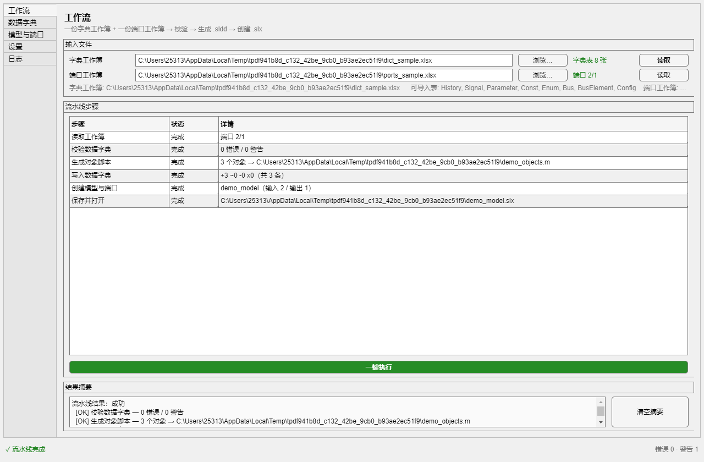

# All_In_One — Simulink 一体化工具（SimWorkbench）

把"数据字典"和"建模"两条工作流合并为一个 MATLAB App：**一个窗口，两份 Excel，一次点击**。

> 状态：**v1.7.1 / P5 已完成**。全量回归 **127/127 通过**（15 个测试类，约 75 s）；可安装包已双形态交付：**`build/SimWorkbench.mlappinstall`（已按 v1.7.1 重打，约 159 KB，双击安装、出现在 Apps 选项卡；包内**不含** `resources/+myPackage`）** 与 `build/SimWorkbench.mltbx`（工具箱，已按 v1.7.1 重打、同样不含 `resources/+myPackage`）。一键验收脚本 `build/final_verify.m` 会依次完成「打包 → 干净安装 → 启动冒烟 → 全量回归」。
> 设计文档：[docs/design/all-in-one-design.md](docs/design/all-in-one-design.md)（v1.0）。旧工具源码 `src/` 已移除（原仓库 `F:\GithubRepos\AutoCreateModel`、`F:\GithubRepos\AutoCreateSldd` 仍在），分析结论留在 `docs/analysis/`。



> 上图为 `tools/preview_ui_run.m` 真实跑完流水线后的工作流页：6 步全部「完成」，产物 `demo.sldd` / `demo_model.slx` / `demo_objects.m` 均落盘。

---

## 快速开始

环境：MATLAB **R2024b**（Update 8）+ Simulink。Python 仅"模板生成/反向同步"需要，可选。

### 方式一：安装 App 安装包 `.mlappinstall`（推荐）

```matlab
cd('F:\GithubRepos\All_In_One');
build\make_appinstaller            % 产出 build\SimWorkbench.mlappinstall（官方 App 打包流程）
matlab.apputil.install(fullfile(pwd,'build','SimWorkbench.mlappinstall'))
```

也可以直接**双击** `build\SimWorkbench.mlappinstall` 安装。安装后从 MATLAB 的 **Apps 选项卡** 点击 `SimWorkbench` 启动（入口会自动把 App 目录加入路径）。

> **命令行安装的已知限制**：`matlab.apputil.install` 在 `-batch` 下只把文件展开到 `%APPDATA%\MathWorks\MATLAB Add-Ons\Apps\SimWorkbench`，**不做 addon 注册**，因此随后 `matlab.apputil.run('SimWorkbenchAPP')` 会报「找不到具有指定标识符的附加功能」（`…\+apputil\run.m` 第 39 行调 `matlab.addons.isAddonEnabled`）。命令行装完后请用下面的绕过入口，或改在桌面 MATLAB 里从 Apps 选项卡安装（桌面安装才会注册）：
>
> ```matlab
> addpath('build'); launch_app      % 直接用安装副本启动，不查 addon 注册表
> ```

### 方式二：安装工具箱 `.mltbx`（备选，v1.7.1）

```matlab
cd('F:\GithubRepos\All_In_One');
build\make_toolbox                 % 产出 build\SimWorkbench.mltbx
matlab.addons.toolbox.installToolbox(fullfile(pwd,'build','SimWorkbench.mltbx'))
SimWorkbench                       % 安装后无需 addpath
```

卸载：`matlab.addons.toolbox.uninstallToolbox(...)` 或「附加功能 → 管理附加功能」。

### 方式三：直接加路径（开发/调试）

```matlab
cd('F:\GithubRepos\All_In_One');
addpath('app');
SimWorkbench
```

> **改动代码后遇到「未定义方法」错误**（例如 `没有为类 'SimWorkbench' 定义方法 'onReadWorkbooks'`）：这是 MATLAB 的类缓存——同一会话里先加载过旧版类，之后修改文件不会自动重载。执行 `clear classes`（或重启 MATLAB）后重试即可；若仍复现，用 `which -all SimWorkbench` 确认没有加载到旧的副本。

首次使用建议顺序：

1. 「工作流」页选择字典工作簿与端口工作簿 →「读取」（会显示识别到的表与能力）；
2. 「数据字典」页勾选表 →「校验所选表」→「生成对象脚本」→「写入 .sldd」；
3. 「模型与端口」页确认模型名/目录/求解器 →「创建模型」；
4. 熟练后直接「工作流」页「一键执行」，步骤表逐行显示状态。

无界面方式（CI/回归）：

```bat
matlab -batch "cd('F:\GithubRepos\All_In_One'); addpath('app'); addpath('tests'); addpath('tools'); smoke_pipeline"
```

---

## 能力概览

| 能力 | 说明 |
|---|---|
| 字典校验 | 必填列/必填值、变量名与 Bus/Enum 键重复、`Bus:` 引用、标识符合法性、Package 与存储类组合、Object 列一致性；Const/Enum 已纳入 |
| 对象脚本 | Excel → `.m`（Signal/Parameter/Const/Bus/BusElement）+ 每个 Enum 一个 classdef |
| 写入 `.sldd` | 增量新增/更新、可选清理多余、写后回读校验；**在局部工作区执行，不污染 base** |
| 反向同步 | `.sldd` → Excel（保留格式，Python openpyxl；缺失时退化） |
| 模板导出 | 一键生成 8 表 Excel 模板（含示例数据 / 空模板；Python 优先，缺失时 MATLAB 退化） |
| 建模 | 求解器、步长、`SystemTargetFile`、`GenCodeOnly`、字典关联、顶层端口块、可选 Code Mapping |
| 端口同步/导出 | 工作簿 ↔ 模型顶层端口增量同步；模型 → 7 列端口工作簿 |
| 覆盖保护 | 覆盖 `.slx` 前生成 `<name>.slx.bak`，路径见 `result.backupFile` |
| 日志/问题 | 统一 `swb.Log` + 带表/行/列定位的问题列表，可复制与导出 |

第一次做字典不必手搓表头：在「数据字典」页点「导出 Excel 模板…」即可生成 8 表模板（含示例数据 / 空模板两种），导出后自动设为当前字典工作簿。

不做：自动连线、算法生成、代码编译、Simulink Test。

---

## 两份 Excel 契约（不合并）

| | 字典工作簿 | 端口工作簿 |
|---|---|---|
| 表结构 | 8 表：`History / Signal / Parameter / Const / Enum / Bus / BusElement / Config` | `Inputs`/`Outputs` 两表，或单表按列 A 的 `Input/Output` 分节 |
| 列 | Signal/Parameter 各 14 列（VariableName…Complexity）；Const 6；Enum 4；Bus 6；BusElement 6 | 7 列：序号 / 端口名称 / 数据类型 / StorageClass / Identifier / HeaderFile / DefinitionFile |
| 用途 | 生成 `.sldd` 对象 | 生成/同步模型顶层端口与映射 |
| 事实来源 | [app/+swb/Schema.m](app/+swb/Schema.m) | [app/+swb/PortTable.m](app/+swb/PortTable.m) |

契约细节（逐表列序、必填、重复键、存储类候选、单表分节规则）见设计文档 §3。**不要**把两份文件合并成一份"统一工作簿"——v0.1 的这一设想已作废。

---

## 目录结构

```
All_In_One/
├─ app/
│  ├─ SimWorkbench.m          # 唯一入口：uifigure + 5 页
│  ├─ +swb/                   # 19 个服务类（无 UI 依赖）
│  │   Schema Workbook PortTable Settings Log Issue PythonService
│  │   Validator ScriptBuilder Dictionary ReverseSync
│  │   ModelBuilder PortSync PortExport CodeMapping Pipeline TemplateConfig
│  │   ModelCatalog           # v1.6 现有模型候选（已打开 + 目录中的 .slx）
│  │   TemplateExport         # v1.7 导出 8 表 Excel 模板（含 MATLAB 退化）
│  │   └─ +ui/TemplateConfigDialog.m  # v1.5 模板 Config 模态编辑器
│  └─ resources/              # python 模板/反向脚本；+myPackage（CSC 注册）不随 App 打包
├─ tests/
│  ├─ runAll.m                # runtests(...,'IncludeSubfolders',true)
│  ├─ +swbtest/               # 15 个测试类、127 个测试方法（含 TestPipeline、TestAppUI、TestModelCatalog、TestTemplateExport、TestTemplateConfig、TestTemplateConfigDialog）
│  ├─ +swbfixture/Workbooks.m # 8 表字典 / 7 列端口 样本生成
│  └─ +swbfixture/golden/     # 旧实现的冻结 golden 样本（objects_legacy.txt / gear_legacy.txt）
├─ tools/                     # smoke_p1 / smoke_dict / smoke_model / smoke_pipeline / preview_ui
├─ docs/
│  ├─ design/all-in-one-design.md   # v1.0 设计（架构、API、契约、修复对照、验收）
│  ├─ analysis/{newmodelapp,autocreatesldd}.md
│  └─ ui/                     # 6 张界面截图（5 页 + 模板 Config 编辑器）
```

---

## 架构

```
UI  SimWorkbench  →  Pipeline.run(cfg)  →  领域服务  →  基础设施
     (布局/渲染)       (编排 steps)        Validator…     Schema/Workbook/…
```

服务层四条规则：

1. 不调用任何界面 API（无 `uifigure/uialert/uigetfile/questdlg`）；
2. 返回结构体（`ok / warnings / errorText`），可恢复问题不用 `throw`；
3. 单对象/单端口失败记 `warnings` 或 `issues` 并继续；
4. 需要用户决定时调用注入的 `AskFcn`/`ConfirmFcn`（未注入则用保守默认）。

因此整个流程可脱离界面在 `matlab -batch` 中跑通。逐类方法签名与 `result` 字段见设计文档 §5。

---

## 五页界面

| 页 | 内容 |
|---|---|
| 工作流 | 两份工作簿路径 + 能力探测、6 行步骤表、一键执行、结果摘要 |
| 数据字典 | 表多选、4 个开关（校验/写前确认/删多余/清 Excel）、脚本与 `.sldd` 路径（默认名跟随字典工作簿，手选路径保留）、校验/预览/生成/写入/反向同步/导出模板、问题表 |
| 模型与端口 | 模型名（**可手写 + 可选现有模型**）/目录/求解器/步长/TLC/GenCodeOnly/字典/端口工作簿/映射/打开/冲突策略、7 列端口预览、创建/更新/导出 |
| 设置 | Python 路径（测试）、默认 TLC、默认冲突策略、模板 Config（编辑对话框，v1.5） |
| 日志 | 实时追加、清空/复制/导出 |

静态截图：[工作流](docs/ui/ui_workflow.png) · [数据字典](docs/ui/ui_dict.png) · [模型与端口](docs/ui/ui_model.png) · [设置](docs/ui/ui_settings.png) · [日志](docs/ui/ui_log.png) · [模板 Config 编辑器](docs/ui/ui_template_config.png)（由 `tools/preview_ui.m` 用测试夹具生成，最后一张是 v1.5 的设置页模态对话框：8 列候选值、一行一个、底部实时计数）。

**模型页的模型名称（v1.6）**：控件是可编辑下拉框——直接键入名称就是新建，从下拉里选一个就是改现有模型。候选包括**已打开的模型**和**保存目录里的 `.slx`**（库文件、非法标识符文件名会被过滤），点「刷新」重新扫描；选中某个现有模型时，保存目录会自动切到它所在目录（手写的名称不会被动）。选好模型后点「导出端口」，默认文件名是 **`<模型名称>_ports.xlsx`**（例如 `MCU_Input` → `MCU_Input_ports.xlsx`），导出成功后端口工作簿自动指向这个文件，接着点「更新端口」就能把改过的 Excel 写回模型。

真实运行截图（`tools/preview_ui_run.m`，跑完一键流水线后抓取）：[工作流](docs/ui/ui_workflow_run.png) · [模型与端口](docs/ui/ui_model_run.png) · [日志](docs/ui/ui_log_run.png)。

---

## 一键流水线

```
读取工作簿 → 校验 → 生成对象脚本 → 写入 .sldd → 创建/更新模型 → 保存并打开
```

- 编排者是 `swb.Pipeline.run(cfg)`，返回 `result.steps`（`name/status/detail`，状态 `ok/failed/skipped/warn`）、`issues`、`dictStats`、`modelResult`、`artifacts`、`summary`。
- UI 把 `steps` 映射到 6 行表格；`StopOnError` 控制遇错即停还是继续收集问题。
- 6 行表格由 `result.steps` 逐条回填（`ok/failed/skipped/warn` → 完成/失败/跳过/警告），第 1 行「读取工作簿」也包含在 `steps` 内——真实运行截图中 6 行全部为「完成」。

相对旧实现的修复（`evalin('base')`、模型无备份、跨目录字典失效、TLC 全路径、反向同步忽略界面路径、Const/Enum 漏校验、Package 冲突中断脚本、映射许可门禁）在设计文档 §6.3 逐条对照。

### 同名模型与覆盖保护（v1.1 起）

- **创建模型前会先看目标目录**：目标 `.slx` 已存在时按「冲突策略」处理（询问 / 覆盖并生成 `<name>.slx.bak` / 加数字后缀 / 取消）；
- **搜索路径上有同名模型也会警告**：即使目标目录为空、模型也没加载，只要 `which -all <ModelName>.slx` 能解析到别的目录，就给出 warning（不误删、不覆盖别人的模型）；
- **保存后校验真实落盘路径**：`save_system` 之后用 `get_param(model,'FileName')` 回读并与目标路径逐级比较，不一致直接报错 `swb:ModelBuilder:unexpectedModelFile`，避免"以为存到了 A，其实写进了 B"。

---

## 测试与验证

| 命令 | 作用 |
|---|---|
| `matlab -batch "…; addpath('app'); addpath('tests'); runAll"` | 全量单元/集成测试（15 类 127 方法，约 75 s） |
| `matlab -batch "…; addpath('build'); final_verify"` | **一键验收**：打包 → 干净安装 → 启动冒烟 → 安装副本修复自检 → 全量回归（报告 `build/final_report.txt`） |
| `addpath('build'); mcp_verify`（经 MATLAB MCP 执行） | 在**可见桌面会话**里跑同一套验收：流水线冒烟 + 全量回归 + App 构造/销毁（报告 `build/mcp_verify_report.txt`） |
| `… addpath('tools'); smoke_p1` | 基础层（Schema/Log/Settings/Workbook/PortTable） |
| `… smoke_dict` | 校验→脚本→写 `.sldd`→反向同步端到端 |
| `… smoke_model` | 建模/端口同步/导出/映射全流程 |
| `… smoke_pipeline` | 一键流水线两次运行（幂等 + `.bak`） |
| `… preview_ui` | 重新生成 `docs/ui/` 下 6 张静态截图（含模板 Config 编辑器对话框） |
| `… preview_ui_run` | 真实跑一次一键流水线，导出 3 张运行截图到 `docs/ui/ui_*_run.png` |
| `… addpath('build'); make_appinstaller` | 重新构建 `build/SimWorkbench.mlappinstall` |
| `… addpath('build'); make_toolbox` | 重新构建 `build/SimWorkbench.mltbx` |

环境实测（R2024b Update 8）：`license('test')` 显示 `Simulink_Coder=0 / Embedded_Coder=0`，但 `coder.mapping` API 实际可用（`initialized=1`、`appliedIn/appliedOut` 生效且可回读），因此 Code Mapping 采用"先试后降级"，不设许可门禁。详见设计文档 §9.4。

**已记录的全量回归**（2026-10-31，R2024b Update 8，v1.7.1）：`127 Passed, 0 Failed, 0 Incomplete`，75.1 s（`matlab -batch` 实测；同机 v1.7 的 124 例为 57.9 s，差异主要来自新增的 App 构造类用例与负载）；测试类分布 TestDictionary 8 / TestModelBuilder 14 / TestModelCatalog 8 / TestPortSync 8 / TestPortExport 7 / TestCodeMapping 8 / TestValidator 13 / TestScriptBuilder 6 / TestPythonService 8 / TestReverseSync 4 / TestPipeline 2 / TestAppUI 10 / TestTemplateConfig 12 / TestTemplateConfigDialog 6 / TestTemplateExport 11。

> 该数字来自 `build/final_verify.m` 的**完整验收序列**（先打包+安装+启动，再跑测试）——此时安装副本的 `+swb` 在 MATLAB 路径上，比"只跑测试"更接近用户真实环境。

### 用 MATLAB MCP 驱动（v1.3 起）

本机装了 MathWorks 的 Agentic Toolkits，其中的 MATLAB MCP Server 可以接到正在运行的桌面 MATLAB 会话上（`evaluate_matlab_code` / `run_matlab_test_file` / `check_matlab_code` 等），因此除了 `matlab -batch`，还有第二条**可见、可交互**的验证路径：

```matlab
addpath('F:\GithubRepos\All_In_One\app', 'F:\GithubRepos\All_In_One\tests', ...
        'F:\GithubRepos\All_In_One\build');
mcp_verify                 % 流水线冒烟 + 127 个测试 + App 构造/销毁
mcp_verify('SkipTests', true)
```

与 `final_verify` 的区别：`final_verify` 面向无头 `-batch`（打包/安装/测试，全部用临时目录），`mcp_verify` 面向桌面会话（不动安装目录、不重打包，只验证「当前工作区的代码在真实 MATLAB 里能跑」）。两者共用同一套测试夹具 `swbfixture.Workbooks`，工作簿都生成在系统临时目录，不会改动仓库与项目文件。

实测（R2024b Update 8，桌面会话，当时套件为 76 个方法）：`PIPELINE_OK=1`、`TEST_TOTAL=76 PASSED=76 FAILED=0`、`APP_CONSTRUCT_OK=1 APP_DELETE_OK=1`；`SimWorkbench()` 在桌面上正常弹出五页窗口，截图存 `build/mcp_desktop_launch.png`。加入 `swbtest.TestAppUI` 后套件为 79 个方法；v1.5 再并入 `swbtest.TestTemplateConfig`（12）与 `swbtest.TestTemplateConfigDialog`（6）并给 `TestAppUI` 加第 4 例，`-batch` 实测 `98/98`（58.21 s）。

> 注意：MCP 连的是桌面会话（`usejava('desktop')=1`），默认 `pwd` 未必是本仓库，务必先 `addpath` 上面的三个目录；`-batch` 与桌面会话的类缓存互不影响，改了 `app/+swb` 后桌面端若报「没有定义方法 …」，执行 `clear classes` 或重启 MATLAB。

---

## 配置

| 内容 | 位置 |
|---|---|
| 机器级设置 | `fullfile(prefdir,'simworkbench.json')`（Python 路径、默认 TLC/冲突策略、最近使用、模板 Config） |
| 项目数据 | 两份 Excel 工作簿（唯一项目级数据源） |
| 日志 | 内存 `Log.Entries`（上限 5000），手动导出，默认不落盘 |

Python 本机实测：`D:\SoftwareInstallation\Python3147\python.exe` + openpyxl 3.1.5。未配置时模板生成/反向同步退化为 MATLAB 基本实现，其余功能不受影响。

---

## 旧工具（已移除）

合并前两个独立 App 的源码副本 `src/` 已删除，仓库不再包含它们；需要行为对照时请直接看原仓库：

- 新建模型：`F:\GithubRepos\AutoCreateModel`（`NewModelApp.m`）；
- 数据字典：`F:\GithubRepos\AutoCreateSldd`（`sldd_gui.m`、`Excel2Workspace.m`）。

原副本的静态分析结论（文件清单、行为契约、SHA-256）留在 `docs/analysis/newmodelapp.md`、`docs/analysis/autocreatesldd.md`。旧实现的行为基线以 `tests/+swbfixture/golden/` 下的冻结样本保留，`TestScriptBuilder` 仍逐字对比。

---

## 进度与待办

| 阶段 | 状态 |
|---|---|
| P1 基础层（Schema/Settings/Log/Workbook/PortTable） | ✅ |
| P2 字典侧（Validator/ScriptBuilder/Dictionary/ReverseSync/PythonService） | ✅ |
| P3 模型侧（ModelBuilder/PortSync/CodeMapping/PortExport） | ✅ |
| P4 UI（五页 + 流水线 + 设置 + 日志） | ✅ |
| P5 交付（回归/打包/文档/边界） | ✅ 127/127 回归通过（v1.7.1）；`.mlappinstall` 与 `.mltbx` 均已按 v1.7.1 重打（两者都不含 `+myPackage`），干净安装/启动冒烟/安装副本自检通过 |
| v1.1 修复 | ✅ 外部同名模型警告、保存后模型路径校验、目标目录为空时也检测外部同名模型 |
| v1.2 验收 | ✅ `build/final_verify.m` 一键验收；`build/launch_app.m` 绕过 addon 注册启动；文档同步到 v1.2 |
| v1.7.1 修复 | ✅ 换字典工作簿后默认输出名不更新的问题：数据字典页的「对象脚本」/「数据字典」原来只在字段为空时填一次默认名，换工作簿就停在旧名字上；现改为**跟随字典工作簿**（`AutoScriptFile`/`AutoSlddFile` 记住上次自动值，字段为空或仍是自动值时才改写 `<base>_objects.m` / `<base>.sldd`，**手选过的路径保留**）。另外两个页面的「字典工作簿」双向同步：数据字典页手改路径会同步到工作流页并重新读取（`onDictWorkbookEdited`），工作流页「读取」也会把数据字典页刷新到同一路径（`syncDictWorkbookEdit`）。新增 `TestAppUI` 3 例（127/127，75.1 s；未重新打包） |
| v1.7.1 打包 | ✅ App 安装包不再包含 `app/resources/+myPackage`：该目录只是本地 CSC 演示包（`useLocalCustomStorageClasses` 的 `@Signal`/`@Parameter` 示例），从源码树运行时由 `swb.Dictionary.ensurePackagePath` 按需 `addpath`；随包发布反而会在安装后把 `resources` 加进路径、遮蔽用户工程自己的 `+myPackage`。`make_appinstaller` 新增 `ExcludeResources`（默认 `{'+myPackage'}`），暂存时递归跳过、打包后解包产物二次校验；`final_verify` 增加安装副本 `INSTALLED_HAS_MYPACKAGE=0` 检查。包版本默认 `'1.6'` → `'1.7.1'`。重打后 `.mlappinstall` **42 个条目（zip 元数据 `version=1.7.1`）、无任何 `+myPackage` 条目**，字节数约 159 KB（精确值见 `build/final_report.txt` 的 `PACKAGE_BYTES`）；`final_verify` 完整验收 `127/127`、`LAUNCH_OK=1`、`INSTALLED_RESOURCES=1`、`INSTALLED_HAS_MYPACKAGE=0`。`.mltbx` 也按同一口径重打（`make_toolbox` 的 `ExcludeResources` + `packageHasEntry` 解包复核；192,549 字节 / 32 个源文件、45 个 zip 项，`Contents.m` 版本 1.7.1，无 `+myPackage`） |
| v1.7.1 发布 | ✅ 定版：v1.7 的功能增补（导出 Excel 模板、默认名跟随字典工作簿、模型候选/默认端口名）与 v1.7.1 的打包口径（App 包与工具箱都不含 `+myPackage`）一并收口，标签 `v1.7.1`；`.mlappinstall` 约 159 KB / 42 项、`.mltbx` 192,549 字节 / 45 项，`final_verify` 127/127 |
| v1.7 新增 | ✅ 「数据字典」页恢复旧工具的「生成模板」入口：新增「导出 Excel 模板…」按钮 + `swb.TemplateExport`（`toWorkbook`/`defaultFile`/`writeMatlabBasic`）。可选「含示例数据（推荐）」或「空模板」，默认文件名沿用旧工具的 `MCU_Template.xlsx`；有 Python 时走 `generate_template.py`，不可用时退化为 MATLAB `writecell` 基本模板（8 表表头 + `Config` 候选值）。导出成功后新工作簿自动成为当前字典工作簿。`ReverseSync` 原有的 `writeMatlabTemplate` 收敛到 `swb.TemplateExport.writeMatlabBasic`（去重）。新增 `TestTemplateExport` 11 例 + `TestAppUI` 第 7 例（124/124，57.9 s；本轮未重新打包，包字节数仍为 v1.6 的 157,433） |
| v1.6 新增 | ✅ 「模型与端口」的模型名称改成**可编辑下拉框**：既能直接手写名称，也能从下拉里选一个现有模型（已打开的模型 + 保存目录里的 `.slx`，库文件与非法标识符文件名自动过滤）；新增 `swb.ModelCatalog`（`list`/`names`/`findByName`/`isFileBacked`）作为候选来源、模型页「刷新」按钮重新扫描、选中现有模型时保存目录自动切到该模型目录（手写名称不受影响）。导出端口默认文件名改为 **`<模型名称>_ports.xlsx`**（`swb.PortExport.defaultFileName`，非法文件名字符替换为下划线），导出成功后端口工作簿自动切到刚导出的文件。新增 `TestModelCatalog` 8 例 + `TestPortExport` 2 例 + `TestAppUI` 2 例（112/112，69.9 s，包 157,433 字节） |
| v1.5 修复 | ✅ 「设置 → 模板 Config → 编辑…」从占位变成真编辑器：新增 `swb.TemplateConfig`（`defaults`/`normalize`/`prepare`/`validate`/`summary`，8 列候选值去重去空白、空列保留、未知列告警、保存前校验）+ `swb.ui.TemplateConfigDialog`（780×700 模态框，8 个「一行一个候选值」文本域 + 实时计数 + 恢复默认/取消/保存）；设置页显示「Config 表候选值：8 列 / N 项（内置默认/已自定义）」摘要；保存即写 `Settings` 并刷新。反向同步生成模板时把 `Settings.TemplateConfig` 传给 `PythonService.generateTemplate`（`generate_template.py --config`），Python 不可用的 MATLAB 退化模板也用它。新增 `TestTemplateConfig` 12 例 + `TestTemplateConfigDialog` 6 例 + `TestAppUI` 第 4 例（98/98，58.21 s，包 151,941 字节） |
| v1.4 修复 | ✅ 文件对话框关闭后 App 重回最前：新增 `raiseApp`/`focusGuard`/`pickOpenFile`/`pickSaveFile`/`pickFolder`/`confirmAndRaise` 六个私有方法（占位图窗 + `DeleteFcn` 回焦，思路来自 JorgWoehl/fixfocus），14 处 `uigetfile`/`uiputfile`/`uigetdir`/`uiconfirm` 调用点全部收口到这层包装；新增 `swbtest.TestAppUI` 3 个用例（79/79 回归通过，48.78 s） |
| v1.3 修复 | ✅ `swb.Pipeline` 支持 `swb.Schema.modelConfigDefaults()` 的字段名（`ModelName`/`ModelFolder`），修复「照文档直接传默认配置时建模步骤被跳过」；新增 `swbtest.TestPipeline` 2 个用例（76/76 回归通过，54.51 s，包约 142 KB）；新增 MCP 驱动验证脚本 `build/mcp_verify.m` |

### 打包与安装

| 形态 | 构建脚本 | 产物 | 安装方式 |
|---|---|---|---|
| **App 安装包（推荐）** | `build/make_appinstaller.m` | `build/SimWorkbench.mlappinstall`（官方 App 打包，OPC 容器 + 元数据） | 双击，或 `matlab.apputil.install('…\\build\\SimWorkbench.mlappinstall')`；装后出现在 **Apps 选项卡** |
| 工具箱 | `build/make_toolbox.m` | `build/SimWorkbench.mltbx` | `matlab.addons.toolbox.installToolbox(...)`；装后直接 `SimWorkbench` |

**`.mlappinstall` 是怎么生成的**：MATLAB 官方入口是 `matlab.apputil.create`（打开打包对话框，需要桌面）与 `matlab.apputil.package`（读 `.prj` 打包，可无头运行）。仓库里的 `build/make_appinstaller.m` 用代码生成与对话框等价的最小 `.prj`（模板 `build/appinstaller_template.xml`，`plugin="plugin.apptool"`、`target="target.mlapps"`），再调用 `matlab.apputil.package`，因此可以完全在 `matlab -batch` 里重建。打包内容就是 `build/appstage/` 下的目录结构：`SimWorkbench.m` + `+swb/` + `resources/`（**不含 `resources/+myPackage`**，见下）+ README/docs，入口点 `SimWorkbench`。

**为什么排除 `resources/+myPackage`**：它只是 CSC（自定义存储类）的本地演示包——`csc_registration.m` 用 `useLocalCustomStorageClasses(h,'myPackage')` 注册 16 个存储类，`@Signal`/`@Parameter` 是示例子类。App 代码里唯一的引用是 `swb.Dictionary.ensurePackagePath`：包已可用就直接返回，否则**仅当** `resources/+myPackage` 存在时才 `addpath`（`onCleanup` 时 `rmpath`）。把它打进安装包没有收益，反而会在安装后把 App 的 `resources` 加进用户路径、**遮蔽用户工程自己的 `+myPackage`**。因此 `make_appinstaller` 默认排除它（`'ExcludeResources', {'+myPackage'}` 可改），并且**打包后会把产物解包再查一遍**（`matlab.apputil.package` 会重做依赖分析，只在暂存目录删掉不等于产物里没有）；`final_verify` 额外断言安装副本里没有该目录（`INSTALLED_HAS_MYPACKAGE=0`），同时确认排除没有误伤运行时资源（`INSTALLED_RESOURCES=1`、`GEN_PY=1`、`CONFIG_JSON=1`）。从源码树运行不受影响（包就在 `app/resources/+myPackage`）。工具箱 `.mltbx` 走另一套脚本（`make_toolbox.m`），但两者共用 `build/copyTreeExcluding.m`（跳过）与 `build/packageHasEntry.m`（产物解包复核），口径一致：默认同样排除 `+myPackage`。

**实测记录**（R2024b Update 8，v1.7.1）：构建产物 **约 159 KB**，zip 内 42 项（v1.6 旧包 45 项 / 157,433 字节 ≈ 154 KB，差的 3 项正是 `resources/+myPackage` 下的 `csc_registration.m`、`@Signal/Signal.m`、`@Parameter/Parameter.m`）（安装包会一并打包 `README.md`/`docs/`，因此每次改文档重打都会浮动几十到几百字节，**精确值以 `build/final_report.txt` 里的 `PACKAGE_BYTES` 为准**）；`matlab.apputil.install` 返回 `id=SimWorkbenchAPP / status=installed`，安装目录生成 `SimWorkbenchApp.m` 包装类与 `+swb/`、`resources/`；通过包装类启动后 `AppHandle` 的类型为 `SimWorkbench`（`LAUNCH_OK=1`、创建 1 个 figure），可正常关闭；安装副本 `+swb/ModelBuilder.m` 含 v1.1 的两处修复（`externalModelFile` / `unexpectedModelFile`）。工具箱 `.mltbx` 同样重打：192,549 字节、45 个 zip 项（32 个源文件 + 元数据）、`Contents.m` 版本 1.7.1、无 `+myPackage` 条目。

**一键验收脚本**：

```matlab
cd('F:\GithubRepos\All_In_One');
addpath('build');
final_verify                       % = final_verify('Version','1.7.1')
final_verify('SkipTests', true)    % 只验打包/安装/启动，不跑回归
```

控制台打印 ASCII 标记（`PACKAGE_BYTES=…`、`INSTALL_ID=…`、`LAUNCH_OK=…`、`TEST_TOTAL=…`）便于脚本抓取，中文详情写 `build/final_report.txt`（UTF-8）。两个实测坑：

1. `matlab.apputil.package` 在**函数工作区**里调用会静默不产出文件——必须在 base 工作区执行（脚本用 `evalin('base', …)` 包一层）；
2. 同一 MATLAB 进程里**先跑 `runtests` 再打包**，Java 打包服务会静默崩溃（进程 exit 1、无错误信息、无产物）。因此验收顺序固定为「打包 → 安装 → 启动 → 测试」。

**启动入口**：`addpath('build'); launch_app` 定位 `%APPDATA%\MathWorks\MATLAB Add-Ons\Apps\SimWorkbench*`（优先 `com.mathworks.appmanagement.MlappinstallUtil.getAppInstallationFolder`），加路径后调 `SimWorkbench()`；失败再退回 `matlab.internal.apputil.AppUtil.genwrapperfilename` + `appinstall.internal.runapp`；未安装则直接用仓库 `app` 目录。

> **卸载提示**：本机实测 `matlab.apputil.uninstall('SimWorkbenchAPP')` 会因注册表不一致报「找不到具有指定标识符的附加功能」；请在 MATLAB **Apps 选项卡 → 右键 SimWorkbench → 卸载**（或在「附加功能 → 管理附加功能」里卸载），删除 `%APPDATA%\\MathWorks\\MATLAB Add-Ons\\Apps\\SimWorkbench` 目录亦可。

> 更正一条早前的错误结论：曾用 `exist('matlab.apputil.create','file')` 返回 0 而认为 `.mlappinstall` 不可用；实际这些是包函数，`which('matlab.apputil.create')` 可以找到（`toolbox/matlab/apps/+matlab/+apputil/`），官方打包路径可用。`exist(...,'file')` 对包函数返回 0，不能作为可用性判据。

### 仍待做（可选增强）

1. 流水线单步重试/断点续跑；
3. 边界用例：空表/仅表头/超长名/非法标识符/跨目录字典/只读目录/Python 缺失；
4. 大工作簿性能（5000+ 行）与高 DPI 布局（**待验证**）；
5. 自定义 TLC 目录当前仅在本次会话 `addpath`，跨会话行为**待验证**；
6. **桌面端验证一次 Apps 选项卡启动**：命令行安装不注册 addon（见「快速开始」下的限制说明），需在桌面 MATLAB 双击安装或从 Apps 选项卡安装后确认能启动/卸载。

---

## 文档索引

| 文档 | 内容 |
|---|---|
| [设计文档 v0.9](docs/design/all-in-one-design.md) | 契约、分层、API 表、流水线、UI、测试、验收、风险 |
| [NewModelApp 分析](docs/analysis/newmodelapp.md) | 旧模型侧逐文件分析（358 行） |
| [AutoCreateSldd 分析](docs/analysis/autocreatesldd.md) | 旧字典侧逐文件分析（324 行） |
| [界面截图](docs/ui/) | 5 页实拍 |

改列定义只改 `app/+swb/Schema.m`；新增服务必须遵守上述四条规则；UI 回调只做"读控件 → 组 `opts` → 调服务 → 渲染"。
