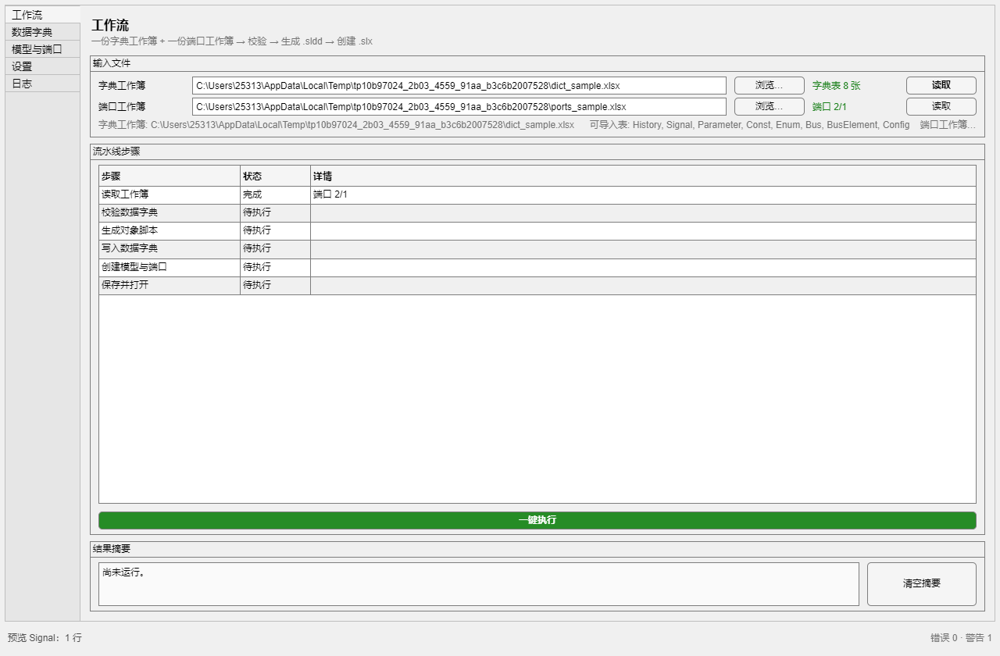
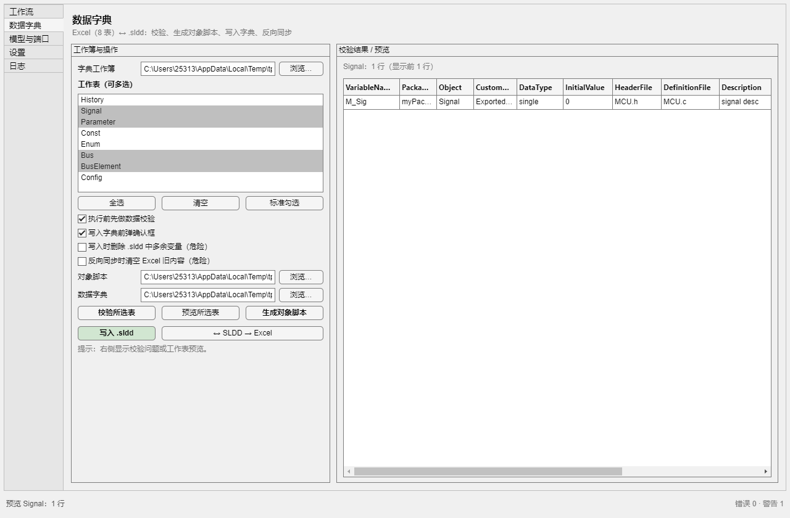
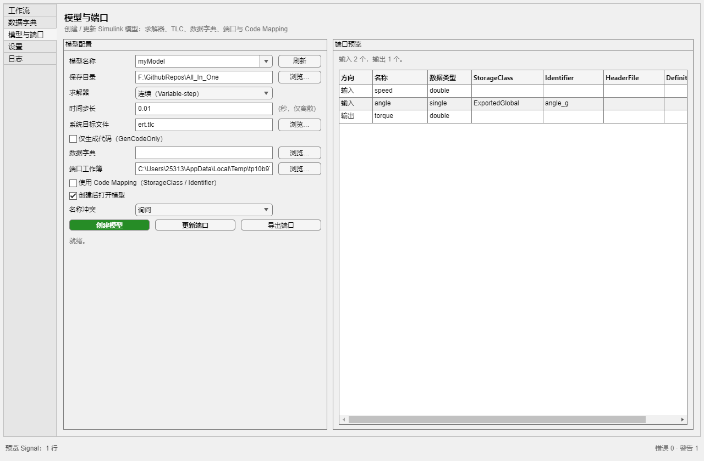
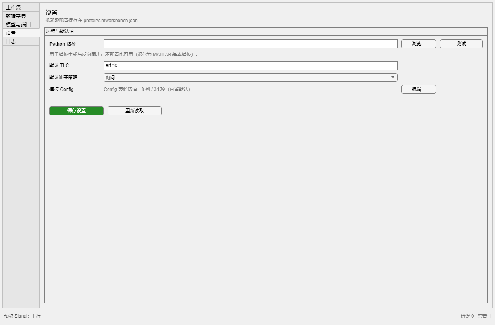
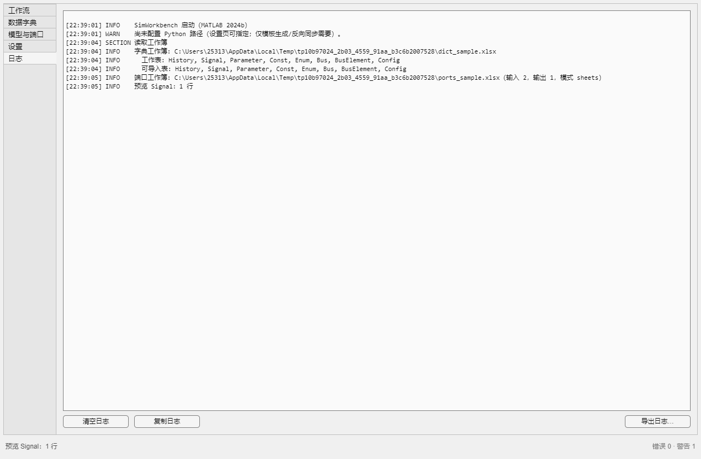
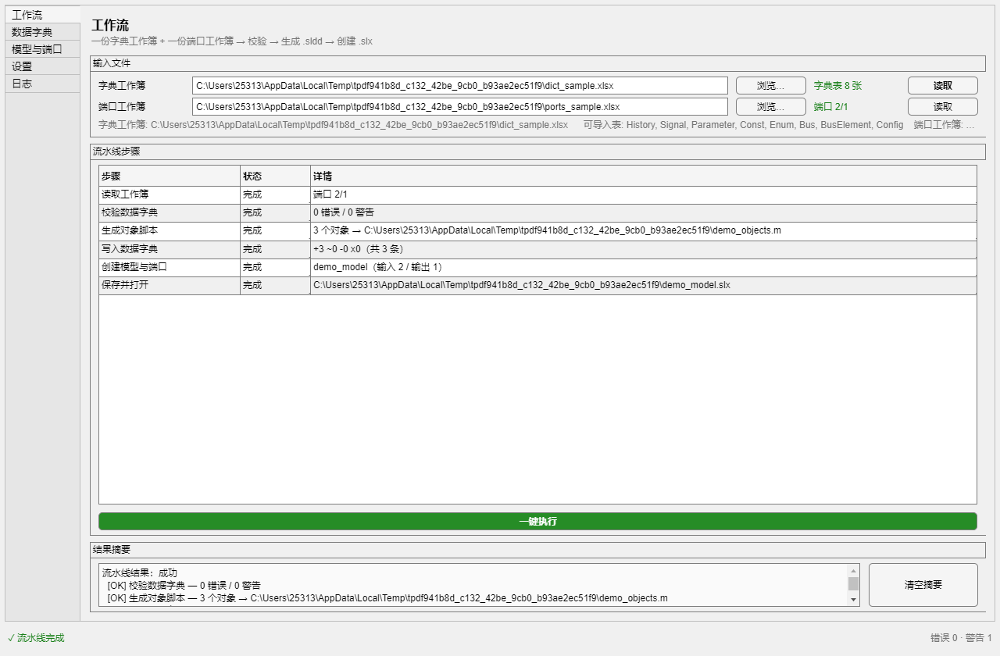
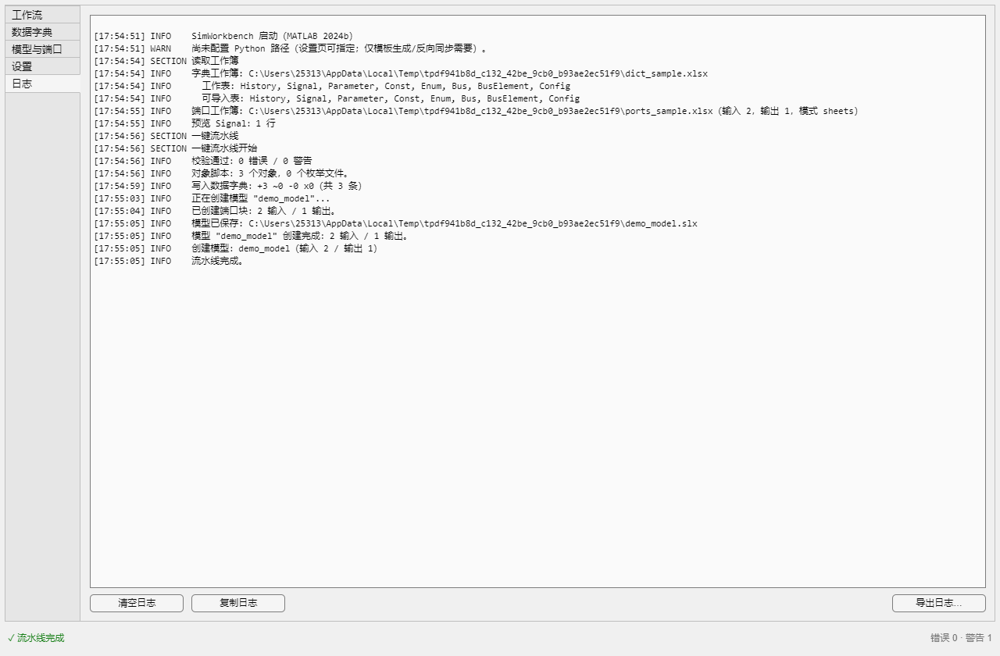

# All-in-One SimWorkbench —— 设计文档（v0.7）

> 状态：**v1.6：P1–P5 已完成**（全量回归 112/112；`.mlappinstall` v1.6（157,433 字节）与 `.mltbx` 均已构建，干净安装/启动冒烟/安装副本自检通过；一键验收脚本 `build/final_verify.m`，桌面侧 `build/mcp_verify.m`）。本文档描述当前代码的真实形态，不是提案。
> 版本历史：v0.2 → v0.3 增补 §6.3 第 11–12 条（同名模型检测、保存后路径校验）、§9.6（v1.1/v1.2 修复与验收脚本）、更新 §9.5、§10、§11 的实测数字；v0.3 → v0.4 增补 §9.6 的 v1.3 条目（`swb.Pipeline` 接受 `Schema.modelConfigDefaults()` 字段名）、§9.1 的 `TestPipeline`（共 76 个方法 / 10 个类）、§9.3/§9.5 的 MATLAB MCP 验证路径（`build/mcp_verify.m`），并把实测数字更新到 v1.3（139,712 字节 / 54.51 s）；v0.4 → v0.5 记录 v1.4 的窗口焦点修复（§9.6 第 14 条，addendum `TestAppUI` 3 例）与 `79/79`、48.78 s 的实测数字；v0.5 → v0.6 记录 v1.5 的模板 Config 编辑对话框（§7.2、§9.6 第 15 条，`swb.TemplateConfig` + `swb.ui.TemplateConfigDialog`），数字更新为 `98/98`、58.21 s、包 150,611 字节；v0.6 → v0.7 记录 v1.6 的「模型名称可编辑下拉 + 现有模型候选 + 导出默认名 `<模型名>_ports.xlsx`」（§5.10、§5.10b、§9.6 第 15–16 条），数字更新为 `112/112`、69.9 s、包 157,433 字节。
> 前版 v0.1 的"统一工作簿（8 表 + Inputs/Outputs + Model 三合一）"方案**已作废**；现行为**两份独立 Excel 契约**（见 §3）。
> 依据：[NewModelApp 分析](../analysis/newmodelapp.md) · [AutoCreateSldd 分析](../analysis/autocreatesldd.md) · 代码：`app/SimWorkbench.m`、`app/+swb/*.m`。
> 旧工具源码 `src/NewModelApp`、`src/AutoCreateSldd` **已移除**（原仓库 `AutoCreateModel`、`AutoCreateSldd` 仍在），仅作功能与实现参考。

---

## 1. 概览

**SimWorkbench** 是一个单窗口 MATLAB App（`classdef SimWorkbench < handle` + `uifigure`），把"数据字典"和"建模"两条工作流收进同一个界面：

```
字典工作簿(8 表) ─┐
                  ├─ 校验 → 生成对象脚本 → 写入 .sldd ─┐
端口工作簿(7 列) ─┘                                    ├─ 创建/更新 .slx（端口 + 字典关联 + Code Mapping）
                                                       ┘
```

| 项 | 值 |
|---|---|
| 入口 | 在 `app` 已入路径时执行 `SimWorkbench` |
| 主类 | [app/SimWorkbench.m](../../app/SimWorkbench.m)（1265 行） |
| 服务层 | [app/+swb/](../../app/+swb/)（16 个类，静态方法为主） |
| 窗口 | `uifigure`，默认 1280×840，左侧 `uitabgroup`（`TabLocation='left'`），5 页 |
| 机器级配置 | `fullfile(prefdir,'simworkbench.json')` |
| 测试 | `tests/runAll.m` + `tests/+swbtest/`（14 个测试类、112 个测试方法，实测全绿） |
| 冒烟/截图 | `tools/smoke_*.m`、`tools/preview_ui.m`（静态）、`tools/preview_ui_run.m`（真实运行） |
| 打包 | `build/make_appinstaller.m` → `build/SimWorkbench.mlappinstall`（官方 App 安装包，双击安装，出现在 Apps 选项卡）；备选 `build/make_toolbox.m` → `build/SimWorkbench.mltbx` |

### 1.1 快速上手

```matlab
cd('F:\GithubRepos\All_In_One');
addpath('app');
SimWorkbench
```

1. 「工作流」页选择字典工作簿与端口工作簿 →「读取」；
2. 「数据字典」页勾选表 →「校验所选表」→「生成对象脚本」→「写入 .sldd」；
3. 「模型与端口」页填模型名/目录 →「创建模型」；
4. 或直接「工作流」页「一键执行」。

### 1.2 界面实拍

| 工作流 | 数据字典 |
|---|---|
|  |  |

| 模型与端口 | 设置 | 日志 |
|---|---|---|
|  |  |  |

静态截图由 `tools/preview_ui.m` 用测试夹具（`tests/+swbfixture/Workbooks.m`）生成，不含真实项目数据（5 页各一张，另加 v1.5 的模板 Config 编辑器对话框 `ui_template_config.png`）。

真实运行截图（`tools/preview_ui_run.m` 真跑一键流水线后抓取，6 步全「完成」）：

| 工作流（运行后） | 日志（运行后） |
|---|---|
|  |  |

---

## 2. 目标与范围

### 2.1 做

- **一份字典工作簿（8 表）**：校验、生成对象脚本（`.m` + Enum classdef）、写入 `.sldd`、从 `.sldd` 反向同步回 Excel。
- **一份端口工作簿（7 列）**：读取/写回、与模型顶层端口增量同步、从模型导出。
- **模型创建**：求解器、`SystemTargetFile`、`GenCodeOnly`、字典关联、端口块、可选 Code Mapping、覆盖前备份。
- **一键流水线**：上述步骤串起来，返回结构化 `result.steps`，UI 逐行显示状态。
- **统一日志/问题列表/设置**：日志页可复制导出；校验问题带表/行/列定位；Python 路径集中在设置页。
- **可单测的服务层**：不依赖界面，`matlab -batch` 可跑。

### 2.2 不做

- 自动连线、算法/控制逻辑生成（端口块之间不接线）。
- 代码生成/编译（只设置 `SystemTargetFile`/`GenCodeOnly`，不触发 build）。
- 需求工具链、Simulink Test、架构设计器。
- 旧工具的历史格式迁移（只兼容旧 Excel 契约本身）。
- 旧 App 的继续维护或双入口同步发布。

---

## 3. 两份 Excel 契约

**两份文件、两套列定义，互不合并**。`swb.Schema` 是列序/必填/别名的唯一事实来源；Python 模板生成也以它为准。

### 3.1 字典工作簿（8 表）

表名大小写不敏感，规范名与顺序：`History, Signal, Parameter, Const, Enum, Bus, BusElement, Config`。只有 `Signal/Parameter/Const/Enum/Bus/BusElement` 可导入（`importable=true`）；`History`/`Config` 不导入。

**Signal / Parameter（各 14 列，列序相同）**

| # | 列 | 说明 |
|---|---|---|
| 1 | VariableName | 对象名，必填，工作簿内唯一 |
| 2 | Package | `myPackage` 或 `Simulink` |
| 3 | Object | `Signal` / `Parameter`，须与所在表一致 |
| 4 | CustomStorageClass | 内置 5 个或自定义 16 个之一 |
| 5 | DataType | `double/single/uint8/.../boolean` 或 `Bus: xxx` |
| 6 | InitialValue | Signal 非必填；**Parameter 必填** |
| 7–8 | HeaderFile / DefinitionFile | 自定义存储类的头/源文件 |
| 9 | Description | 注释 |
| 10–11 | Min / Max | 取值范围 |
| 12 | Unit | 单位 |
| 13 | Dimensions | 维度，默认 `1` |
| 14 | Complexity | `real` / `complex` |

必填列：Signal = 1–5；Parameter = 1–6。重复键 = 第 1 列。

**Const（6 列）**：`Name, Package, CustomStorageClass, Value, DataType, HeaderFile`；必填 1–3，键 1。

**Enum（4 列）**：`EnumName, EnumNumbers, Value, DataType`；必填 1–4，键 = (EnumName, EnumNumbers)。每个枚举生成独立 `<EnumName>.m` classdef。

**Bus（6 列）**：`BusName, Description, HeaderFile, Alignment, PreserveElementDimensions, DataScope`；必填 1、3、4、5、6，键 1。

**BusElement（6 列）**：`BusName, ElementName, DataType, Dimensions, Description, Unit`；必填 1–4，键 = (BusName, ElementName)。

**History（4 列）**：`Version, ChangeDate, Changer, Content`；仅记录，不导入。

**Config（8 列 A–H）**：`Package, Object, Storage class, Data Type, Unit, DimensionsMode, Complexity, DataScope`；只作 Excel 下拉候选值的数据源，不导入。默认候选值见 `swb.Schema.defaultConfig()`。

**存储类候选**

- 内置（5）：`Auto, SimulinkGlobal, ExportedGlobal, ImportedExtern, ImportedExternPointer`
- 自定义（16，来自 `app/resources/+myPackage/csc_registration.m`）：`YS_SelectRAMSignal, YS_SelectRAMPara, BitField, Const, Volatile, ConstVolatile, Define, ImportedDefine, ExportToFile, ImportFromFile, FileScope, Localizable, Struct, GetSet, CompilerFlag, Reusable`
- 内存段（5）：`YS_RAMSignal, YS_RAMPara, MemConst, MemVolatile, MemConstVolatile`
- 约束：`Package=Simulink` 的行只能用内置存储类；自定义存储类必须配 `myPackage`。

### 3.2 端口工作簿（7 列）

| # | 列 | 映射字段 | 说明 |
|---|---|---|---|
| 1 | 序号 | `row`（仅内部记录行号） | 可空 |
| 2 | 端口名称 | `name` | 顶层 Inport/Outport 块名，须为合法标识符 |
| 3 | 数据类型 | `dataType` | 写入 `OutDataTypeStr` |
| 4 | StorageClass | `storageClass` | 写入 Code Mapping |
| 5 | Identifier | `identifier` | C 标识符 |
| 6 | HeaderFile | `headerFile` | 映射头文件 |
| 7 | DefinitionFile | `definitionFile` | 映射定义文件 |

**表结构两种都接受**（`swb.PortTable.read`）：

1. 两个工作表 `Inputs`/`Outputs`（别名 `Input/输入`、`Output/输出`，忽略大小写）；
2. 单工作表按列 A 的分节标题 `Input`/`Output`（及中文别名）拆分。

首行表头自动识别并跳过；缺失表头时按 7 列顺序解析。空行忽略。解析结果字段：`name, dataType, storageClass, identifier, headerFile, definitionFile, row`。

### 3.3 命名与产物约定

| 产物 | 默认命名 | 产生位置 |
|---|---|---|
| 对象脚本 | `<字典工作簿名>_objects.m` | 字典工作簿同目录（可覆盖） |
| 数据字典 | `<字典工作簿名>.sldd` | 字典工作簿同目录（可覆盖） |
| 枚举类 | `<EnumName>.m` | 字典工作簿/脚本同目录 |
| 模型 | `<ModelName>.slx` | 模型页"保存目录" |
| 覆盖备份 | `<ModelName>.slx.bak` | 同模型目录，路径在 `result.backupFile` |
| 端口导出 | 用户选择，默认 `ports.xlsx` | `uiputfile` |

统计文本格式沿用旧工具：`+新增 ~更新 -跳过 x失败`。

---

## 4. 架构分层

### 4.1 分层图

```
UI            app/SimWorkbench.m（只做布局、读控件、渲染结果、订阅日志）
               │  cfg / opts                    ▲  result / Log 事件
编排          swb.Pipeline.run(cfg) → result.steps
               │
领域服务       Validator  ScriptBuilder  Dictionary  ReverseSync
              ModelBuilder  PortSync  PortExport  CodeMapping
               │
基础设施       Schema  Workbook  PortTable  Settings  Log  Issue  PythonService
```

| 层 | 类 | 职责 |
|---|---|---|
| UI | `SimWorkbench` | 5 页布局、文件选择、调用服务、步骤表/日志/摘要渲染 |
| 编排 | `Pipeline` | 按顺序调服务，收集 `steps/issues/artifacts`，决定中止或继续 |
| 领域 | `Validator` `ScriptBuilder` `Dictionary` `ReverseSync` `ModelBuilder` `PortSync` `PortExport` `CodeMapping` | 校验、脚本生成、字典读写、反向同步、建模、端口同步/导出、映射 |
| 基础 | `Schema` `Workbook` `PortTable` `Settings` `Log` `Issue` `PythonService` | 契约常量、Excel 读取、端口表读写、配置、日志、问题条目、Python 调用 |

### 4.2 服务层四条规则（所有 `+swb` 类共同遵守）

1. **不调用任何界面 API**：不出现 `uifigure/uialert/uigetfile/questdlg/uiconfirm`；不引用 `app`。
2. **返回值是结构体**：`ok / warnings / errorText`（有的还有 `stats/issues/artifacts`）。**不靠 throw 传递可恢复问题**；只有参数非法、工作簿不存在这类不可恢复错误才 `error('swb:...')`。
3. **可恢复问题进 `warnings`/`issues`**：单端口失败、单对象失败、TLC 设置失败、字典不存在等都要记录并继续。
4. **需要用户决定时用注入回调**：`opts.AskFcn` / `opts.ConfirmFcn`（`Pipeline` 用 `cfg.AskFcn/ConfirmFcn`）。未注入时使用保守默认（例如模型重名默认"加数字后缀"）。

派生约定：日志只经 `swb.Log`（`opts.Log`），服务层不写状态栏、不 `drawnow`。

### 4.3 旧代码的定位（已移除）

- `NewModelApp.m`（1546 行，原仓库 AutoCreateModel）：模型侧行为的参照实现。服务层已迁移其创建/改端口/导出流程，但去掉了"逻辑全在 UI 回调里"的结构。
- `sldd_gui.m`（1189 行等，原仓库 AutoCreateSldd）：字典侧参照实现。`Excel2Workspace`/`validateDataDictionary`/`sldd_to_excel` 的逻辑分别落到 `ScriptBuilder`/`Validator`/`ReverseSync`。
- 两个旧 App 的源码副本已删除；行为基线由 `tests/+swbfixture/golden/` 下的冻结样本保留（`TestScriptBuilder` 逐字对比）。`app/resources` 保留了 `+myPackage` 与两个 Python 脚本。
- `+myPackage` 未被任何 `.m` 直接调用；Simulink 通过 CSC 注册机制解析。`swb.Dictionary` 在写脚本期间临时把 `app/resources` 加入路径。

---

## 5. 模块 API 表

签名均为静态方法（除 `Settings`/`Log` 为 handle 类）。`opts` 未列全时以类注释为准。

### 5.1 `swb.Schema`（契约常量）

| 方法 | 签名 | 返回 |
|---|---|---|
| 字典表规格 | `spec = dictSheetSpec(name)` | `name, columns, required, keyColumns, importable` |
| 可导入表 | `names = importableSheetNames()` | 6 个表名 |
| 列/必填 | `cols = dictColumns(name)` / `req = requiredColumns(name)` | cellstr / 索引 |
| Config | `c = configColumns()` / `cfg = defaultConfig()` / `keys = configKeys()` | 键/字母/表头；默认候选值 |
| 存储类 | `customStorageClasses()` / `builtinStorageClasses()` / `allStorageClasses()` / `memorySections()` / `packageNames()` | cellstr |
| 端口 | `portColumns()` / `portFieldNames()` / `blankPort()` / `portSheetMap()` | 7 列 / 6 字段 / 空端口 struct |
| 模型默认 | `d = modelConfigDefaults()` | `ModelName, ModelFolder, SolverType, SampleTime, SystemTargetFile, GenCodeOnly, DictFile, PortWorkbook, ApplyCodeMapping, OpenAfterCreate, ConflictPolicy` |
| 表头归一 | `normalizeHeader(h)` / `matchColumns(headers, canonical)` | 归一化名 / 列索引 |

### 5.2 `swb.Workbook`（只读 Excel 层）

| 方法 | 签名 | 返回 |
|---|---|---|
| 能力探测 | `info = detect(filePath)` | `path, exists, sheets, dictSheets, hasDict, inputSheets, outputSheets, hasPorts, warnings` |
| 端口表匹配 | `[inSheets, outSheets] = matchPortSheets(sheets)` | 命中的别名表 |
| 原始读取 | `raw = readRaw(filePath, sheetName)` | cell |
| 表读取 | `t = readSheetTable(filePath, sheetName)` | table（保序、字符串化） |
| 表列表 | `sheets = listSheets(filePath)` | cellstr |

### 5.3 `swb.PortTable`（端口工作簿读写）

| 方法 | 签名 | 返回 |
|---|---|---|
| 读 | `[inPorts, outPorts, info] = read(filePath)` | 端口 struct 数组；`info.mode='sheets'` 或 `'sections'` |
| 解析 | `ports = parse(raw, sheetName)` | 端口 struct 数组 |
| 分节 | `[inRaw, outRaw] = splitSections(raw)` | 两张原始 cell |
| 写 | `write(filePath, inPorts, outPorts)` | 生成 `Inputs`/`Outputs` 两表 |
| 校验 | `issues = validate(inPorts, outPorts)` | `swb.Issue` 数组（重名、C 标识符等） |
| 计数 | `n = total(ports)` | 端口数 |

### 5.4 `swb.Validator`（字典校验）

`issues = run(workbookPath, selectedSheets)` → `swb.Issue` 数组，不抛校验错误。
规则：必填列/必填值、变量名重复、Bus 名重复、BusElement 键重复、`Bus:` 引用存在性、MATLAB/C 标识符、Package 与存储类组合、Object 列一致性、DataType 合法性、Enum 基类型与重复值、未选表提示。Const/Enum 已纳入。

### 5.5 `swb.ScriptBuilder`（Excel → 对象脚本）

`result = build(workbookPath, selection, outFile)`

| 字段 | 说明 |
|---|---|
| `ok` | 是否成功 |
| `text` | 生成的脚本文本（不落盘也返回） |
| `objects` | `name, type, constructor, sheet` |
| `busElements` | `bus, name, sheet` |
| `enumFiles` / `enumTexts` | 枚举文件名 / `name, path, content` |
| `writtenFile` | 实际写出的 `.m`（`outFile` 为空时为空串） |
| `warnings` | cellstr |

行为：Bus/BusElement 先于引用；BusElement 用 `saveVarsTmp{1}` 临时变量；Parameter 先 `Dimensions` 后 `Value`；`Package=Simulink` 配自定义存储类时**不生成必崩行**，改用 try/catch 包裹并在 warnings 说明。

### 5.6 `swb.Dictionary`（对象 → `.sldd`）

| 方法 | 签名 | 说明 |
|---|---|---|
| 写入 | `stats = writeScript(dictPath, scriptText, opts)` | `opts: CleanExtra(false), ConfirmFcn([]), Log([]), Verify(true)` |
| 打开/新建 | `[dict, isNew] = openOrCreate(dictPath)` | 返回 Simulink 字典句柄 |
| 关闭 | `close(dict)` | 幂等 |
| 读条目 | `entries = readEntries(dictPath)` | `Name, Type, ClassName, Value` |

`stats` 字段：`ok, added, updated, skipped, failed, failedNames, cleaned, totalBefore, totalAfter, dictCreated, errorText, verifyMissing, messages`。

关键实现：**不在 `evalin('base')` 执行**，脚本在局部函数工作区 `eval`；只接管 `Simulink.Signal/Parameter/Bus` 三类；每对象独立 try/catch；字典句柄 `onCleanup`；写后默认回读校验。

### 5.7 `swb.ModelBuilder`（建模）

`result = create(opts)` / `result = configure(modelName, opts)`

`opts`：`Name, Folder, SolverType, SampleTime, SystemTargetFile, GenCodeOnly, DictFile, PortWorkbook, ApplyCodeMapping, OpenAfterCreate, ConflictPolicy, AskFcn, Log`（`configure` 另有 `SaveAfter`）。同时接受 `ModelName/ModelFolder` 别名。

`result` 字段：`ok, modelName, modelPath, inputCount, outputCount, mapping(struct), warnings, errorText, cancelled, dictFile, systemTargetFile, backupFile`。

流程：名称校验 → 冲突处理（**覆盖前备份 `.slx.bak`**）→ `new_system/open_system` → 求解器 → TLC → `GenCodeOnly` → 字典关联（**回读校验**）→ 端口块 → Save#1 → Code Mapping → Save#2 → 按需关闭。

`AskFcn` 约定：`AskFcn('question', msg, {'覆盖','加数字后缀','取消'}, 2)`，返回下标或文字；未注入时默认加数字后缀。

### 5.8 `swb.PortSync`（端口增量同步）

| 方法 | 签名 | 返回 |
|---|---|---|
| 读现有端口 | `[inPorts, outPorts] = existing(modelName)` | `name, dataType, position, blockPath`（仅顶层） |
| 应用 | `stats = apply(modelName, inPorts, outPorts, opts)` | `ok, added, removed, updated, unchanged, warnings, errorText` |

`modelName` 可为模型名或 `.slx/.mdl` 全路径（修复旧实现"浏览其它目录的模型后找不到"）。按名字增/删/改，只协调数据类型。调用前未加载则结束后按 `SaveAfter` 保存并关闭；已加载则保持。
**已知行为**：删除有连线的端口会丢连线，`warnings` 中逐条说明，不静默。

### 5.9 `swb.CodeMapping`（映射）

| 方法 | 签名 | 返回 |
|---|---|---|
| 许可诊断 | `tf = available()` | 仅诊断，不参与 `apply` 决策 |
| 应用 | `stats = apply(modelName, inPorts, outPorts, opts)` | `initialized, initError, appliedInput, appliedOutput, failedInput, failedOutput` |
| 回读 | `rows = read(modelName)` | `name, storageClass, identifier, headerFile, definitionFile` |
| 空结构 | `blankStats()` / `emptyRows()` | 便于初始化 |

**许可策略是"先试后降级"**：直接 `coder.mapping.utils.create`，成功就映射；抛错则 `initialized=false` + `initError`，模型照常创建。不靠 `license('test')` 提前拦截（本机实测无 Coder 许可时 API 仍可用）。每端口独立 try/catch，失败端口名汇总。

### 5.10 `swb.PortExport`（模型 → 端口工作簿）

`result = write(modelName, outFile, opts)` → `ok, inputCount, outputCount, mappingRead, file, warnings, errorText`。
复用 `PortSync.existing` + `CodeMapping.read` + `PortTable.write`；无映射时降级为只导出端口列；自动清理多余 `Sheet1`；导出后恢复模型加载状态。

默认文件名（v1.6）：`f = defaultFileName(modelName)` → `<模型名称>_ports.xlsx`，非法文件名字符（`\ / : * ? " < > |` 与空白）替换为下划线，空名称退回 `ports.xlsx`；`f = defaultFile(modelName, folder)` 在 `folder`（缺省 `pwd`）下拼出该文件名。界面「导出端口」用 `pickSaveFile` 把它作为默认值，导出成功后端口工作簿自动指向该文件。

### 5.10b `swb.ModelCatalog`（现有模型候选，v1.6）

「模型与端口」页的模型名称是可编辑下拉框（既能手写、也能选现有），候选由它提供：

| 方法 | 签名 | 返回 |
|---|---|---|
| 列表 | `items = list(folder)` | struct 数组：`name, folder, file, loaded, source('loaded'\|'file')` |
| 名称 | `names = names(folder)` | cellstr，按名称排序去重 |
| 查找 | `info = findByName(name)` | 单个 item 或 `[]`（先已打开模型，再搜索路径） |
| 判定 | `tf = isFileBacked(info)` | 是否有真实 .slx 文件 |

已打开的模型优先（带真实文件目录），同名目录文件去重；库文件（`BlockDiagramType ~= 'model'`）与不是合法标识符的文件名被过滤。无 UI 依赖，可单测（`TestModelCatalog` 8 例）。

### 5.11 `swb.ReverseSync`（`.sldd` → Excel）

`result = toWorkbook(dictPath, workbookPath, opts)`（`opts: CleanExcel(false), PythonService/Exe, Log`）
→ `ok, rows(Signal/Parameter/Const/Bus/BusElement/Enum 计数), workbookCreated, messages, errorText, exitCode, stdout, dictPath, workbookPath`。

流程：读本地条目 → 分类 → 组装 JSON → `sldd_to_excel_helper.py` 写回（保留格式）；Enum 从字典同目录 `*.m` 扫描。目标工作簿不存在时优先 `generate_template.py --empty`，Python 不可用则退化为 MATLAB `writecell` 基本模板。**使用界面中的字典路径**，不再强制弹窗。

### 5.12 `swb.PythonService`

| 方法 | 签名 | 返回 |
|---|---|---|
| 解析 | `exe = resolve(settings)` | 可用 Python 全路径或 `''` |
| 校验 | `[ok, msg] = validate(exe)` | 运行 `--version` |
| 模板 | `r = generateTemplate(outFile, opts)` | `ok, message, exe, script, cmd, exitCode, stdout, stderr, outFile` |
| 反向 helper | `r = runReverseHelper(jsonFile, opts)` | 同上 |
| 脚本定位 | `p = scriptPath(name)` | `app/resources/*.py`（绝对路径 + `system`） |

Python 路径只来自配置（`Settings.PythonPath` 或显式 `opts.Exe`），**不做自动搜索**；找不到返回 `ok=false` + 可读消息，不抛错。

### 5.13 `swb.Pipeline`（编排）

`result = run(cfg)`

`cfg`：`DictWorkbook, PortWorkbook, Sheets, ScriptFile, SlddFile, Model, ValidateFirst(true), ConfirmWrite(false), ConfirmFcn, CleanExtra(false), StopOnError(true), AskFcn, Log`。

`result`：`ok, steps(name/status/detail), issues, dictStats, modelResult, artifacts(scriptFile/slddFile/modelFile), summary, warnings, errorText`。
`steps.status` ∈ `ok | failed | skipped | warn`；只编排，不实现业务。

### 5.14 `swb.Settings`（handle）

属性：`File, PythonPath, DefaultTlc, LastDictWorkbook, LastPortWorkbook, LastOutputDir, ConflictPolicy, TemplateConfig`。
方法：`load()`、`save()`、`tf = hasPythonPath()`。默认文件 `fullfile(prefdir,'simworkbench.json')`。

### 5.15 `swb.Log`（handle）

属性：`Entries(time/level/message), Callback, MaxEntries(5000), Progress, ProgressMessage, ProgressCallback`。
方法：`info/warn/err/debug/section(fmt,...)`、`progress(fraction, fmt,...)`、`txt = text()`、`clear()`、`n = count(level)`、`tf = hasErrors()`。UI 通过 `Callback` 实时追加到日志页；测试直接读 `Entries`。

### 5.16 `swb.Issue`（值对象）

`make(sheet,row,column,severity,message)`、`concat(a,b)`、`count(list,severity)`、`hasErrors(list)`、`format(list)`。字段：`sheet, row, column, severity('error'|'warning'|'info'), message`。

---

## 6. 一键流水线

### 6.1 步骤

```
读取工作簿 → 校验(A) → 生成对象脚本(B) → 写入 .sldd(C) → 创建/更新模型(D) → 保存并打开(E)
```

| # | 步骤 | 实现 | 失败策略 |
|---|---|---|---|
| 1 | 读取工作簿 | UI 的「读取」按钮 / `Workbook.detect` | 文件不存在则后续步骤 skipped |
| 2 | 校验数据字典 | `Validator.run` | 有 error 且 `StopOnError` 则中止；否则继续并记 issues |
| 3 | 生成对象脚本 | `ScriptBuilder.build` | 生成失败且 `StopOnError` 则中止 |
| 4 | 写入 `.sldd` | `Dictionary.writeScript` | 单项失败不中断；`failed>0` 标记 warn |
| 5 | 创建/更新模型 | `ModelBuilder.create`（端口、字典、映射） | 失败记 failed；`cancelled` 记 skipped |
| 6 | 保存并打开 | `ModelBuilder` 内部 Save#1/#2 + `OpenAfterCreate` | — |

流水线只发 5 种 step 名（`字典工作簿/校验数据字典/生成对象脚本/写入数据字典/创建模型`），第 1 步与第 6 步由 UI 状态驱动，见 §6.2。

### 6.2 UI 进度映射

「工作流」页步骤表固定 6 行：`读取工作簿, 校验数据字典, 生成对象脚本, 写入数据字典, 创建模型与端口, 保存并打开`。
`onRunPipeline` 把 `result.steps` 的 `ok/failed/skipped/warn` 转成 `完成/失败/跳过/警告`；模型文件存在则第 6 行置"完成"。
**已知缺口**：`Pipeline` 不返回"读取工作簿"步骤，因此第 1 行不会由一次"一键执行"回填（点「读取」时也不写步骤表）。标记为后续修正项，不影响产物。

### 6.3 相对旧实现的修复（逐条）

| # | 旧问题 | 现实现 |
|---|---|---|
| 1 | `evalin('base')` 执行对象脚本，污染基础工作区 | `Dictionary.evalScriptText` 在局部函数工作区 `eval`，只取回对象列表；测试断言 base 无新增变量 |
| 2 | 覆盖已有模型直接删除，无备份 | 覆盖前复制 `<name>.slx.bak`，路径写入 `result.backupFile`，UI 日志提示 |
| 3 | 字典关联只传文件名，跨目录失效 | `resolveDictPath` 解析相对/绝对路径；必要时 `addpath` 字典目录，`set_param` 后 `get_param` 回读校验 |
| 4 | 浏览的 TLC 全路径直接塞 `SystemTargetFile` | 先判存在性并取 basename；`set_param` 失败时临时 `addpath` 目录重试一次，仍失败则 warning 跳过（不再中断） |
| 5 | 反向同步忽略界面里的字典路径，强制弹窗 | `ReverseSync.toWorkbook(dictPath, ...)` 直接用 UI 路径 |
| 6 | Const/Enum 不参与校验，Enum 不进对象清单 | `Validator` 覆盖 Const/Enum；`ScriptBuilder` 生成 Enum classdef 并列入 `enumFiles` |
| 7 | 字典不存在时模型只能警告 | 流水线第 4 步保证先生成 `.sldd`，再建模型并关联 |
| 8 | 浏览其它目录的模型后"改端口"找不到 | `PortSync/PortExport/CodeMapping` 统一 `resolveModelRef`，保存绝对路径并优先按路径 `load_system` |
| 9 | `Package=Simulink` + 自定义 CSC 让整段脚本中断 | `ScriptBuilder` 按 Package 预判不生成必崩行；其余 CSC 赋值 try/catch；单对象失败只计数 |
| 10 | 无 Coder 许可时映射被提前拦截 | `CodeMapping.apply` 先尝试 `coder.mapping.utils.create`，失败才降级并给 `initError` |
| 11 | 搜索路径上的同名模型被静默顶替/覆盖（v1.1） | 目标目录之外解析到同名 `.slx` 时只 warning 来源，**不改动外部文件**；详见 §9.6 |
| 12 | `save_system` 后不校验落盘路径（v1.1） | 保存后回读 `FileName` 与目标逐级比较，不一致即报 `swb:ModelBuilder:unexpectedModelFile`；详见 §9.6 |

**已核实不是 bug**：R2024b 的 `setInport/getInport` 允许根级端口名（`block` 可为 path/handle/name），旧代码传裸端口名合法；只有在子系统内才必须用路径。

---

## 7. UI 说明

### 7.1 主窗口

- `SimWorkbench('Visible','off')` 可无头构造（截图/测试用）；`'SettingsFile'` 可注入临时配置。
- 布局：`uigridlayout([2,1])`，上为 `uitabgroup`（5 页，左侧标签），下为状态栏。
- 关闭走 `CloseRequestFcn → onClose`，删除 figure。
- 公开方法：`populateDemo(dictWorkbook, portWorkbook)`（绕过文件框填充真实数据并读取）、`setTab(title)`（按标题切页）。

### 7.2 五页

| 页 | 内容 | 主要动作 |
|---|---|---|
| 工作流 | 字典/端口工作簿路径 + 能力探测标签 + 6 行步骤表 + 结果摘要 | 读取、一键执行、清空摘要 |
| 数据字典 | 左侧 420px：工作表多选、4 个开关（校验/写前确认/删多余/清 Excel）、脚本与 `.sldd` 路径、5 个动作按钮；右侧：问题表（工作表/行/列/级别/问题）或预览表 | 校验所选表、预览所选表、生成对象脚本、写入 `.sldd`、`↔ SLDD → Excel` |
| 模型与端口 | 模型名/目录/求解器/步长/TLC/GenCodeOnly/字典/端口工作簿/Code Mapping/创建后打开/冲突策略；右侧 7 列端口预览 | 创建模型、更新端口、导出端口 |
| 设置 | Python 路径（浏览/测试）、默认 TLC、默认冲突策略、模板 Config（编辑对话框，v1.5）、保存/重读 | 保存设置、重新读取、编辑模板 Config |
| 日志 | 等宽文本区，实时追加；清空/复制/导出 | 复制走 `clipboard('copy')`；导出为 `.log/.txt` |

- 数据字典页 4 个开关默认：校验开、写前确认开、删除多余变量关、清空 Excel 关（与旧 App 一致）。
- 模型页默认值全部来自 `Schema.modelConfigDefaults()`：`myModel / Continuous / 0.01 / ert.tlc / GenCodeOnly=false / ApplyCodeMapping=false / OpenAfterCreate=true / ConflictPolicy=ask`。
- 冲突策略"询问"通过注入的 `AskFcn = @(msg,options,defaultIdx) uiconfirm(...)` 实现；服务层不知道 `uiconfirm`。
- 设置页「模板 Config」第 5 行是**可换行摘要标签**（`swb.TemplateConfig.summary()` → `Config 表候选值：8 列 / N 项（内置默认/已自定义）`），右侧「编辑…」打开 v1.5 的模态编辑器（`swb.ui.TemplateConfigDialog`，780×700）：8 行「键名（Config!列字母）+ 文本域（一行一个候选值）」滚动面板 + 实时计数；保存时 `prepare` 规范化（去重/去首尾空白/丢空行/空列保留/未知列告警）再 `validate`（8 键齐全、非空字符串、不含换行与制表符、不能全空），不通过则 `uialert` 拒绝；成功后写 `Settings.TemplateConfig` 并 `Settings.save()`，warnings 进日志，摘要即时刷新。该值同时供反向同步（`ReverseSync` 的 `opts.Config` → `PythonService.generateTemplate` 的 `--config`）与 Python 不可用时的退化模板 `writeMatlabTemplate(workbookPath, cfg)` 使用。

---

## 8. 配置与设置

| 内容 | 位置 | 说明 |
|---|---|---|
| 机器级设置 | `fullfile(prefdir,'simworkbench.json')` | 避开 Program Files 只读；键：PythonPath、DefaultTlc、Last*、ConflictPolicy、TemplateConfig |
| 项目级模型参数 | 模型页控件（当前不写入工作簿） | v0.1 设想的 `Model` 表**已作废**，不再读取 |
| 端口与字典数据 | 两份 Excel 工作簿 | 唯一项目级数据源 |
| 运行日志 | 内存 `Log.Entries`（上限 5000 条），可导出 | 默认不落盘 |
| Python | `Settings.PythonPath` | 仅模板生成/反向同步需要；缺失时退化 |

本机实测路径：`D:\SoftwareInstallation\Python3147\python.exe`（openpyxl 3.1.5）。

---

## 9. 测试与验证

### 9.1 单元/集成测试

`tests/runAll.m`：`runtests(here,'IncludeSubfolders',true)`，有失败则 `error('swb:testFailed')`。

| 文件 | 覆盖 |
|---|---|
| `tests/+swbtest/TestDictionary.m`（8） | 新建/增量/幂等/清理多余/失败隔离/不污染 base/回读 |
| `tests/+swbtest/TestModelBuilder.m`（14） | 连续/离散、非法参数、suffix/overwrite+bak/cancel/ask、OpenAfterCreate、端口、字典回读、configure、**外部同名模型只警告不改动**、**保存后路径校验** |
| `tests/+swbtest/TestPortSync.m`（8） | 读现有、加载状态恢复、增删改、幂等、连线告警 |
| `tests/+swbtest/TestPortExport.m`（7） | 7 列导出、往返读回、状态恢复、默认文件名 `defaultFileName`/`defaultFile` |
| `tests/+swbtest/TestModelCatalog.m`（8） | 目录文件/已打开模型/排序去重/库文件与非法文件名过滤/`findByName` 搜索路径/目录不存在 |
| `tests/+swbtest/TestCodeMapping.m`（8） | 无许可也尝试映射、字段完整性、回读 |
| `tests/+swbtest/TestValidator.m`（13） | 必填列/必填值、跨表重名、`Bus:` 引用、标识符、存储类、Package 与 CSC 组合、Enum 重复值 |
| `tests/+swbtest/TestScriptBuilder.m`（6） | 对象脚本文本、Enum classdef 文件、CustomStorageClass 组合不中断 |
| `tests/+swbtest/TestPythonService.m`（8） | Python 解析/校验、模板生成、helper 调用、解释器缺失退化 |
| `tests/+swbtest/TestReverseSync.m`（4） | 新建/合并工作簿、Enum 多行 JSON 编码、Python 缺失退化 |
| `tests/+swbtest/TestPipeline.m`（2） | `Schema.modelConfigDefaults()` 字段名（`ModelName`/`ModelFolder`）能直接驱动流水线建模；空 `cfg.Model` 时建模步骤为 `skipped` |
| `tests/+swbtest/TestAppUI.m`（3） | 六个焦点私有方法存在；源码里 `uigetfile`/`uiputfile`/`uigetdir`/`uiconfirm` 只剩包装方法内的直调、业务调用点全部走 `pick*`/`confirmAndRaise`；`SimWorkbench` 能构造与销毁 |
| `tests/+swbfixture/Workbooks.m` | `makeDict`（8 表合法样本）、`makePort`（7 列样本），只写 `tempdir` |
| `tests/+swbtest/SwbTestBase.m` | 路径夹具、临时目录、`bdclose('all')` 清理 |

共 112 个测试方法（14 个类）；模型侧测试需要 Simulink。全量 `runAll` 实测：`112 Passed, 0 Failed, 0 Incomplete`，69.9 s（R2024b Update 8，在安装副本已入路径的完整验收序列下测得）；桌面会话经 MCP 单跑 `TestPipeline` 为 2.0 s / 0.6 s 两例通过。

### 9.2 冒烟脚本（`tools/`）

| 脚本 | 用途 |
|---|---|
| `smoke_p1.m` | Schema/Log/Settings/Workbook/PortTable 基础层 |
| `smoke_dict.m` | 校验→脚本→写 `.sldd`→读条目→Python 反向同步端到端 |
| `smoke_model.m` | ModelBuilder / PortSync / PortExport / CodeMapping 全流程（205 行，分段打印） |
| `smoke_pipeline.m` | 一键流水线两次运行（第二次验证幂等与 `.bak`） |
| `preview_ui_run.m` | 真实跑一次一键流水线后导出 3 张运行截图（`docs/ui/ui_*_run.png`） |
| `preview_ui.m` | 构造 App + 夹具，导出 5 页静态截图 + 模板 Config 编辑器对话框到 `docs/ui/`（6 张） |

### 9.3 运行命令

```bat
:: 全量测试
matlab -batch "cd('F:\GithubRepos\All_In_One'); addpath('app'); addpath('tests'); runAll"

:: 一键流水线冒烟
matlab -batch "cd('F:\GithubRepos\All_In_One'); addpath('app'); addpath('tests'); addpath('tools'); smoke_pipeline"

:: 重新生成 UI 截图
matlab -batch "cd('F:\GithubRepos\All_In_One'); addpath('app'); addpath('tests'); addpath('tools'); preview_ui"

:: 一键验收（打包 → 干净安装 → 启动冒烟 → 全量回归）
matlab -batch "cd('F:\GithubRepos\All_In_One'); addpath('build'); final_verify"

:: 命令行启动安装副本（绕过 addon 注册表）
matlab -batch "cd('F:\GithubRepos\All_In_One'); addpath('build'); launch_app"
```

桌面会话（经 MATLAB MCP 的 `evaluate_matlab_code` 执行，见 §9.4）：

```matlab
addpath('F:\GithubRepos\All_In_One\app', 'F:\GithubRepos\All_In_One\tests', ...
        'F:\GithubRepos\All_In_One\build');
mcp_verify                    % 流水线冒烟 + 112 个测试 + App 构造/销毁
mcp_verify('SkipTests', true) % 只跑流水线冒烟与 App 冒烟
```

`runAll` 也支持 `runAll('Verbosity',2)`。

### 9.4 环境与实测结论

| 项 | 值 |
|---|---|
| MATLAB | `E:\MATLAB\R2024b`（R2024b Update 8） |
| `license('test')` | Simulink=1、Simulink_Coder=0、Embedded_Coder=0、MATLAB_Coder=1 |
| `coder.mapping` | 实测可用：`initialized=1`，`setInport/setOutport` 的 `appliedIn/appliedOut` 生效且可回读 |
| 无头运行 | `matlab -batch` 可跑完整流水线（含建模型/写字典/映射） |
| Python | `D:\SoftwareInstallation\Python3147\python.exe`，openpyxl 3.1.5 |
| 图形 | `exportapp` 可导出 5 页 PNG；`Visible='off'` 下可构造并渲染 |
| MATLAB MCP | Agentic Toolkits 的 MATLAB MCP Server 已接入桌面会话（`evaluate_matlab_code` 可执行并回传输出）；`SimWorkbench()` 在桌面上正常弹出五页窗口（截图 `build/mcp_desktop_launch.png`）。MCP 不替代 `-batch`：前者连可见桌面会话（`usejava('desktop')=1`），后者是无头回归 |

**结论**：许可测试为 0 不代表映射不可用，因此 `CodeMapping` 采用"先试后降级"，不设许可门禁；这也解释了 `available()` 只作诊断。

### 9.5 全量回归与打包（实测记录）

| 项 | 结果 |
|---|---|
| 全量回归 | `matlab -batch "… addpath('build'); final_verify"`（打包→安装→启动→测试）→ `79 Passed, 0 Failed, 0 Incomplete`，48.78 s；只跑测试（`runAll`）同数字但耗时略短 |
| 测试类分布 | TestDictionary 8 / TestModelBuilder 14 / TestModelCatalog 8 / TestPortSync 8 / TestPortExport 7 / TestCodeMapping 8 / TestValidator 13 / TestScriptBuilder 6 / TestPythonService 8 / TestReverseSync 4 / TestPipeline 2 / TestAppUI 6 / TestTemplateConfig 12 / TestTemplateConfigDialog 6 |
| 打包路径（App） | 官方入口可用：`matlab.apputil.create`（需桌面，生成 .prj）与 `matlab.apputil.package`（可无头）；`which` 可解析到 `toolbox/matlab/apps/+matlab/+apputil/`。早前 `exist(...,'file')=0` 是误判（该函数对包函数返回 0） |
| 产物（App） | `build/make_appinstaller.m` 生成与对话框等价的最小 `.prj`（模板 `build/appinstaller_template.xml`，`plugin="plugin.apptool"` / `target="target.mlapps"`）→ `matlab.apputil.package` → `build/SimWorkbench.mlappinstall`（**v1.5：151,941 字节 ≈ 148 KB**；精确值见 `build/final_report.txt` 的 `PACKAGE_BYTES`；`SimWorkbench.m` + `+swb/` + `resources/` + README/docs，入口 `SimWorkbench`） |
| 安装验证（App） | 干净安装（先删 `%APPDATA%\MathWorks\MATLAB Add-Ons\Apps\SimWorkbench`）后 `matlab.apputil.install` 返回 `id=SimWorkbenchAPP / status=installed`；安装目录生成 `SimWorkbenchApp.m` 包装类；`SimWorkbenchApp()` 启动后 `AppHandle` 类型为 `SimWorkbench`（`LAUNCH_OK=1`，新建 1 个 figure）且可关闭。安装副本 `+swb/ModelBuilder.m` 含 `externalModelFile`/`unexpectedModelFile`（v1.1 修复） |
| 验收脚本 | `build/final_verify.m`：打包 → 干净安装 → 启动冒烟 → 安装副本修复自检 → 全量回归，报告 `build/final_report.txt`（UTF-8），控制台只打 ASCII 标记 |
| 桌面侧验收 | `build/mcp_verify.m`：在可见桌面会话（MATLAB MCP）里跑流水线冒烟 + 全量回归 + App 构造/销毁，报告 `build/mcp_verify_report.txt`；不动安装目录、不重打包，用 `swbfixture` 在 `tempdir` 造工作簿。实测 `PIPELINE_OK=1`、`TEST_TOTAL=76 PASSED=76`（当时套件 76 例；加入 `TestAppUI` 后 `-batch` 为 79/79、48.78 s；v1.5 为 98/98、58.21 s）、`APP_CONSTRUCT_OK=1`、`APP_DELETE_OK=1` |
| 命令行启动限制 | `-batch` 下 `matlab.apputil.install` **不注册 addon**，`matlab.apputil.run('SimWorkbenchAPP')` 报「找不到具有指定标识符的附加功能」（`…\+apputil\run.m:39` → `matlab.addons.isAddonEnabled`）。绕过：`addpath('build'); launch_app`（`appinstall.internal.runapp` 本身不查注册表） |
| 产物（工具箱） | `build/make_toolbox.m` → `build/SimWorkbench.mltbx`（32 个文件，自动生成 `Contents.m`）；安装后直接 `SimWorkbench` |
| 安装往返 | `matlab.addons.toolbox.installToolbox(...)` 返回 Name `SimWorkbench` Version `1.0.0`；安装后 `which SimWorkbench` 指向 Add-Ons 目录、`exist('swb.Pipeline','class')==8`；`uninstallToolbox` 后路径清理干净 |
| 真实运行 | `tools/preview_ui_run.m` 用夹具跑完整流水线，6 步全「完成」，产出 `.sldd`/`.slx`/`_objects.m`，截图见 §1 |

---

### 9.6 v1.1 / v1.2 / v1.3 / v1.4 / v1.5 / v1.6 增补（同名模型、保存校验、验收脚本、流水线字段名、窗口焦点、模板 Config 编辑器、模型候选/导出命名）

**v1.1：建模安全（`swb.ModelBuilder`）**

| # | 问题 | 修复 |
|---|---|---|
| 11 | 目标目录为空、模型未加载时，若搜索路径上已有同名模型，创建会"看起来成功"却写到别处（旧代码完全不检测） | 把外部同名检测移到提前 `return` 之前：只要 `externalModelFile`（按 `which -all <Name>.slx` 在目标目录之外解析到 `.slx`）非空，就 warning 提示来源目录，**不改动、不覆盖**该文件；新增测试 `TestModelBuilder/testExternalSameNameModelOnPathNeverTouched` 断言外部文件 mtime 不变 |
| 12 | `save_system` 后不校验真实落盘位置，模型同名索引导致"存到了 A、实际是 B" | 保存后用 `get_param(model,'FileName')` 回读，与目标路径做 `canonicalDir` 逐级比较，不一致抛 `swb:ModelBuilder:unexpectedModelFile`（提示改用其它模型名称） |

**v1.2：验收链路加固**

| 事项 | 结论 |
|---|---|
| `build/final_verify.m` | 打包 → 干净安装 → 启动冒烟 → 安装副本修复自检 → 全量回归；参数 `Version` / `SkipTests`；报告写 `build/final_report.txt` |
| 打包必须在 base 工作区 | `matlab.apputil.package` 在函数工作区内调用会**静默不产出** `.mlappinstall`；脚本用 `evalin('base', …)` 执行 |
| 打包必须在测试之前 | 同一进程内先 `runtests` 再 `apputil.package`，Java 打包服务静默崩溃（进程 exit 1、无错误文本、无产物）。因此验收顺序固定为「打包/安装/启动 → 测试」 |
| 测试定位仓库根不能用 `which` | v1.2 时 `tests/+swbtest/TestScriptBuilder.m` 的 `legacyDir()` 用 `which('swb.Schema')` 反推仓库根；安装副本在路径上时会解析到 `…\Apps\SimWorkbench\+swb\Schema.m`，进而找不存在的 `…\Apps\src\AutoCreateSldd`（`MATLAB:automation:io:FileIO:InvalidFolder`）。该测试现改为对比 `tests/+swbfixture/golden/` 下的冻结样本，`legacyDir()` 已删除 |
| `build/launch_app.m` | 定位安装目录（`com.mathworks.appmanagement.MlappinstallUtil.getAppInstallationFolder` 优先）→ `addpath` → `SimWorkbench()`；失败退回 `matlab.internal.apputil.AppUtil.genwrapperfilename` + `appinstall.internal.runapp`；未安装则用仓库 `app` 目录 |
| Apps 选项卡注册 | 桌面双击/Apps 选项卡安装才会写 addon 注册表；`-batch` 安装只展开文件。命令行场景请用 `launch_app` |

**v1.3：流水线字段名兼容（`swb.Pipeline`）**

| # | 问题 | 修复 |
|---|---|---|
| 13 | `Pipeline.m` 建模步骤只认 `cfg.Model.Name`，而 `Schema.modelConfigDefaults()` 返回 `ModelName`/`ModelFolder`——照头注释示例直接传默认配置时，第 4 步恒为 `skipped`「未指定模型名称」，一键流水线静默不建模型 | 建模步骤前补别名搬运：`ModelName→Name`、`ModelFolder→Folder`（与 `ModelBuilder.normalizeOpts` 的 alias 表一致），并改 `Pipeline` 头注释；新增 `TestPipeline`（2 例）覆盖「默认字段名能建模」「空 `cfg.Model` 仍跳过」 |

**v1.4：文件对话框后窗口失焦（`SimWorkbench`）**

| # | 问题 | 修复 |
|---|---|---|
| 14 | 从「工作流」页选完 Excel 关闭对话框后，`uifigure` 退到后台、不再置顶；用户必须先点一下窗口才能继续操作 | 根因：R2024b 的 `uigetfile`/`uiputfile`/`uigetdir` **没有父窗口参数**（`uigetfile(uifig,{'*.xlsx'},'x')` 直接报「Filterspec 必须为字符向量或字符串或字符向量元胞数组」），`uiconfirm` 虽接受父窗口但关闭后同样不置顶。做法：新增 6 个私有方法——`raiseApp`（`figure(fig); drawnow` 把主窗口提回最前）、`focusGuard`（在 App 标题栏位置建一个高度 0、`Visible` 先 `on`→`drawnow`→`off` 的普通 `figure`，`DeleteFcn` 调 `raiseApp`，仅在 `usejava('desktop')=1` 且窗口 `Visible='on'` 时启用）、`pickOpenFile`/`pickSaveFile`/`pickFolder`/`confirmAndRaise`（各自 `focusGuard` → 弹对话框 → `delete(guard)` → `raiseApp`，异常时先 `delete(guard)` 再 `rethrow`）。14 处业务调用点全部收口到这四个包装方法；无桌面环境（`-batch`）自动退化为直调，不影响测试与流水线。思路参考 JorgWoehl/fixfocus（2024-05-13）的占位图窗技巧。新增 `TestAppUI`（3 例）锁住「方法存在 + 调用点集中 + App 可构造」 |

**v1.6：模型名称可选现有模型 + 导出默认命名（`swb.ModelCatalog` / `swb.PortExport.defaultFileName`）**

| # | 问题 | 修复 |
|---|---|---|
| 15 | 「模型与端口」的模型名称只能手写，想对**已存在的模型**导出端口时得手动敲名字 + 手动找保存目录，容易敲错、导错目录 | 模型名称改成**可编辑下拉框**（`uidropdown(...,'Editable','on')`，R2024b 实测手写值与 Items 刷新可共存）：候选来自新增的 `swb.ModelCatalog`——已打开模型（带真实文件目录、优先）+ 保存目录里的 `.slx`，库文件与非法标识符文件名过滤，按名称排序去重；右侧「刷新」按钮重扫；选中现有模型时保存目录自动切到该模型目录（手写名称不受影响）。`TestAppUI` 用真实控件回调（刷新按钮 / ValueChangedFcn）验证，不靠私有方法直调 |
| 16 | 导出端口的工作簿名固定在界面上手选，与模型名不挂钩；导出后还得手动把「端口工作簿」改成刚导出的文件才能「更新端口」 | 新增 `swb.PortExport.defaultFileName(modelName)` → `<模型名称>_ports.xlsx`（非法文件名字符与空白替换为下划线，空名退回 `ports.xlsx`）与 `defaultFile(modelName, folder)`；「导出端口」用它作 `pickSaveFile` 默认文件名，导出成功后端口工作簿自动指向该文件 |

> 实测（v1.6，R2024b Update 8）：全量 `runAll` **112/112** 通过（69.9 s，14 个类）；`.mlappinstall` 157,433 字节、`.mltbx` 187,216 字节；`final_verify('Version','1.6','SkipTests',true)` → `LAUNCH_OK=1`、`INSTALLED_HAS_FIXES external=1 guard=1`，安装副本含 `+swb\ModelCatalog.m`、可编辑下拉与 `defaultFileName` 调用。桌面会话经 MCP 实测：刷新后候选含现有模型、手写值刷新后保留、选模型切目录、`MCU_Input` → `MCU_Input_ports.xlsx`。

---

## 10. 风险与限制

| 风险/限制 | 影响 | 现状与缓解 |
|---|---|---|
| 全量回归 | — | **已记录**：112/112 通过（69.9 s），命令见 §9.3 / §9.6；`build/final_verify.m` 可一键复现 |
| 打包 | — | **已完成**：官方 `.mlappinstall` v1.5（151,941 字节 ≈ 148 KB，`build/make_appinstaller.m`）与 `.mltbx` 工具箱（183,912 字节 / 34 文件，`build/make_toolbox.m`）双形态，干净安装/启动冒烟/安装副本自检通过（§9.5、§9.6）。卸载不要用 `matlab.apputil.uninstall`（本机注册表不一致会报错），用 Apps 选项卡右键 |
| 流水线字段名 | 照文档传 `Schema.modelConfigDefaults()` 会跳过建模 | **已处理**（v1.3，§9.6 第 13 条）：`Pipeline` 接受 `ModelName/ModelFolder` 别名，`TestPipeline` 覆盖 |
| 对话框后失焦 | 选完 Excel 窗口退到后台 | **已处理**（v1.4，§9.6 第 14 条）：占位图窗 + `DeleteFcn` 回焦，14 处调用点收口；桌面端需人工确认观感 |
| 命令行安装不注册 addon | `apputil.run` 报「找不到具有指定标识符的附加功能」 | **已知限制**：桌面安装才写注册表；命令行用 `launch_app`（§9.6） |
| 同名模型 | 可能误判"创建成功"却写到别处 | **已处理**（v1.1，§9.6 第 11–12 条）：外部同名只警告不改动，保存后校验落盘路径 |
| 设置页模板 Config 无编辑界面 | 只能手改 JSON | **已处理**（v1.5，§9.6 第 15 条）：模态编辑器编辑 8 列候选值，保存前规范化+校验 |
| 流水线第 1 步回填 | — | **已完成**：`Pipeline` 返回的 `steps` 含「读取工作簿」，UI 逐条回填；真实运行截图 6 行全为「完成」（§6.2） |
| Code Mapping 依赖环境 | 换机器可能真失败 | 失败只置 `initError`，模型仍创建；UI 显示失败端口 |
| 删除有连线端口 | 连线丢失 | `PortSync` 逐条 warning，不静默；调用方确认 |
| `.sldd` 文件锁/并发写 | 字典损坏 | 单所有权 + `onCleanup`；未做跨进程锁 |
| 自定义 TLC 目录只在本次会话 `addpath` | 重启 MATLAB 后生成代码可能找不到 TLC | warning 明示目录；长期行为**待验证** |
| 大工作簿性能 | UI 卡顿 | 同步执行，无后台任务；5000+ 行**待验证** |
| 4K/缩放布局 | 控件可能挤压 | 全部用 `uigridlayout`，但仅在 1280×840 下截图验证（**待验证**） |
| 端口表单表分节的表头识别 | 非标准表头可能误判 | 已做首行表头识别与别名；特殊格式**待验证** |
| 旧 App 长期不维护 | 与新契约漂移 | 明确"仅参考"，README 标注 |

---

## 11. 进度与后续

| 阶段 | 内容 | 状态 |
|---|---|---|
| P1 基础层 | `Schema/Settings/Log/Workbook/PortTable` + 冒烟 | ✅ 完成 |
| P2 字典侧 | `Validator/ScriptBuilder/Dictionary/ReverseSync/PythonService` | ✅ 完成；冒烟与单测覆盖 |
| P3 模型侧 | `ModelBuilder/PortSync/CodeMapping/PortExport` | ✅ 完成；建模型/改端口/导出/映射已实测 |
| P4 UI | `SimWorkbench` 五页 + 流水线 + 设置 + 日志 | ✅ 完成；模型页 create/update/export、6 步进度表已接线 |
| P5 交付 | 全量回归、打包、文档、边界用例 | ✅ 112/112 回归通过；`.mlappinstall` v1.6 + `.mltbx` 构建、干净安装/启动冒烟/安装副本自检通过 |
| v1.1 | 建模安全：外部同名模型检测、保存后路径校验 | ✅ 完成（§9.6） |
| v1.2 | 一键验收脚本、`launch_app` 绕过入口、文档同步 | ✅ 完成（§9.6） |
| v1.3 | `Pipeline` 字段名兼容 + `TestPipeline`；MATLAB MCP 桌面验证脚本 `build/mcp_verify.m` | ✅ 完成（§9.6 第 13 条、§9.3、§9.5） |
| v1.4 | 文件对话框后窗口回焦（6 个私有方法 + 14 处调用点收口）+ `TestAppUI` | ✅ 完成（§9.6 第 14 条） |
| v1.5 | 设置页模板 Config 编辑对话框（`swb.TemplateConfig` + `swb.ui.TemplateConfigDialog`）并接入反向同步模板生成 | ✅ 完成（§9.6 第 15 条，`TestTemplateConfig` 12 例 + `TestTemplateConfigDialog` 6 例） |

**P5 剩余工作（按优先级）**

1. ~~跑一次完整 `runAll`，把结果记录到本节~~ → 已完成：79/79，48.78 s（§9.5、§9.6）。
2. ~~建 `.prj` 打包工程，产出 `.mlappinstall`~~ → 已完成：`build/make_appinstaller.m` 生成等价 `.prj` 并调用官方 `matlab.apputil.package` 产出 `build/SimWorkbench.mlappinstall`；另有 `.mltbx` 备选。安装说明见 §9.5。
3. **桌面端验证一次 Apps 选项卡启动/卸载**：命令行安装不注册 addon（§9.6），需在桌面 MATLAB 双击安装或从 Apps 选项卡安装后确认。
4. ~~设置页「模板 Config」编辑对话框（增删候选值、写回 `Settings.TemplateConfig`）~~ → 已完成（v1.5，§9.6 第 15 条）。
5. 流水线单步重试/断点续跑。
6. 边界用例：空表、只有表头、超长名称、非法标识符、跨目录字典、只读目录、Python 缺失。
7. 性能：大工作簿读取/写入的耗时与 UI 响应（5000+ 行）；高 DPI/缩放布局——均**待验证**。

**交接提示**：改列定义只改 `app/+swb/Schema.m`；新增服务必须遵守 §4.2 四条规则；UI 回调只做"读控件→组 opts→调服务→渲染"，不要把业务写进 `SimWorkbench`。
